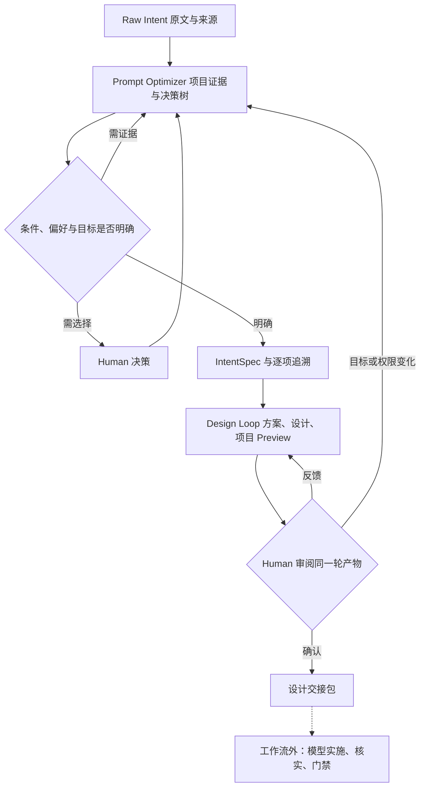

# Intent / Design 工作流 v2

本协议落实 [W02 的六项要求](../../../../doc/tasks/W02-intent-design-workflow.md)。工作流的职责是把业务意图变成经 Human 确认、可交接的方案与项目预览；实施模型在工作流外负责计划、落地、核实和门禁。现有 Issue/任务仍是权威，不新增状态服务。

## 入口与退出

工作流状态为 RAW_CAPTURED / NEEDS_EVIDENCE / NEEDS_DECISION / INTENT_READY / DESIGN_REVIEW / NEEDS_REBASE / DESIGN_HANDOFF。READY 只是可供审阅。允许的设计文件编辑与预览工程修改必须来自真实任务授权，加载 Skill 不产生权限。

## 1. 保留 Raw，再优化

保留原始文本、来源、时间、SHA256；多条来源逐条保存，不能只留下优化后的提示词。优化器输出 objective、outcome、角色/对象、范围、硬约束、验收、可用条件、偏好、权限、未知项、备选解释和逐项 raw → Intent → 设计/验收的追溯。优化提示词是派生物，不能反向覆盖原文。

先读取 AGENTS、实际任务、`doc/workflow/project-profile.md`，再按任务关键词有界检索：`doc/architecture/adr/`、`doc/contracts/`、`doc/product/`、`doc/journeys/`、两端 `doc/`、相关任务和现有源码/测试。使用 rg 和 Git 历史，不默认建向量库，不把所有历史全文塞入上下文。

每项引用记录路径、完整 commit、内容摘要、定位、与当前任务的关系以及用途。ADR 区分 accepted / proposed / superseded / conflict；当前源码另标 current_source，普通文档标 documented，未知就是 unknown。历史 ADR 的 accepted 只说明当时采纳，仍须检查是否被后续 ADR 取代。proposed 不升级为约束；历史能力不升级为当前实现。冲突同时列出，权限或业务意义冲突交 Human，不能由模型暗中挑一个。

## 2. 决策树：先查事实，再问必要选择

| 首个匹配条件 | 动作与出口 |
| --- | --- |
| 违反硬约束或需要扩大授权 | BLOCKED，指出冲突，不改写要求求绿 |
| 可从仓库/资料查清的关键事实不足 | NEEDS_EVIDENCE，最多两轮有界只读研究，再报告缺口和责任方 |
| 影响目标、业务规则、权限、费用、不可逆风险、规则例外的选择未定 | NEEDS_DECISION，展示依据、互斥选项、推荐与代价，等待真实决策 |
| 项目使用条件、资源或偏好会改变方案 | 只问尚无答案的分支；记录 Human 答案或明确授权的可逆默认值 |
| 无阻塞且每项要求可追溯 | INTENT_READY，按风险和既有授权交 Human 确认，再进入 Design |

决策树至少覆盖：目标用户与环境/规模/语言，当前流程与成功条件，可用 API/数据/账号/测试环境，时间/预算/人员/工具，自动化与批量偏好，风险边界与可接受取舍。不是每项都问一遍。已有明确要求直接引用；纯展示选择可在已授权范围采用现有规范。凭据只记录安全提供方式，不写秘密值。

每个决策节点保存 ID、触发条件、问题、事实/来源、选项及取舍、推荐依据、答案/来源、阻塞性和影响哪些产物。资源状态使用 available / missing / unknown / not_applicable；missing 与 unknown 保留 owner、补齐动作和阻塞范围。Mock 可用于设计，不能将依赖标成真实 available。可继续不受阻塞的设计，但不进入不具备条件的实施。

## 3. Design Loop 每轮同时有方案与可操作预览

不再要求 Human 先批准空壳预览，之后才看到完整方案。每轮都形成可审阅的最小完整包，反馈后局部修订；初版可标 draft，阻塞项必须暴露。

| 产物 | 必含内容 |
| --- | --- |
| `solution.md` | 背景、问题、影响范围、目标、使用条件、备选与选择理由、模块流程、自动化/批量取舍、依赖与风险；回答如何解决 |
| `requirements.md` | 编号 R/AC、保留项、角色/权限、成功/失败/恢复定义、非目标 |
| `design.md` | 页面/交互、状态与契约、现有组件/服务复用、源码落点、边界、实现与验证建议；回答如何组织实现 |
| `journey.md`、`flow.mmd` | 入口、对象、理解、动作、影响确认、结果与恢复；每步映射 Screen/State ID 和 AC |
| `ux-analysis.yaml` | b2b-product-ux 唯一模板，八维上下文、九维适用性/义务/证据，未测量保持未验证 |
| 项目 Preview | 同一轮源码快照、可运行入口、种子/场景、复现命令、截图和浏览器运行记录、真实/模拟边界 |
| `design-loop.json` | 以下引用与摘要的交接索引；不替代上述权威内容或任务状态 |

方案和设计各自表达其职责，共同引用同一条业务规则，不复制成两套规格。非 UI 任务保留方案/设计/流程，明确 UX/可视化不适用的理由；不得为后台协议伪造一个用户界面。UI 任务不允许以此豁免。

## 4. Preview 必须长在当前项目里

- 在 `frontend/apps/console` 的现有应用中做任务限定的预览入口和页面，复用壳层、路由、语言、主题、Token、权限语义与实际组件；不另建应用或用独立 `demo.html` 代替。
- 在单独设计分支或 worktree 修改任务授权的预览文件。入口显式仅用于本地/设计构建，生产构建不得暴露预览路由、fixture 或演示写入；切换到真实产品必须经过后续实施任务。
- 模拟数据走预览限定的 service/fixture，隔离存储与租户；不得调用真实业务写接口。可模拟拟议能力，但必须在审阅说明和 demo 外层标识模拟边界，不能把模拟结果说成后端已具备能力；产品页面内保持业务语言。
- 交接索引记录 frontend-relative 源文件及摘要、现有组件/服务复用依据、route、启动命令、预览候选 Git SHA 和 artifact 版本。项目源码、方案、demo 或场景变化即使路由未变也使旧审阅失效。
- 提供直接可打开的预览地址；不能发布时给可执行启动命令和路径。截图是辅助，Human 必须能按场景走完旅程。模型负责先跑目标浏览器旅程，确认交互、主要错误/恢复、主题/语言和 Desktop 规范；不可用时保持 DESIGN_REVIEW / NEEDS_EVIDENCE，不伪造运行记录。
- 适用目标视口为 1366×768、1440×900、1536×1024。Preview 所需有界构建/浏览器核实由实施模型负责，设计工作流记录证据；不授权 Full。

## 5. 把用户注意力留给核心工作

遵循 [.agents/skills/b2b-product-ux](../../b2b-product-ux/SKILL.md)。每步区分 system / human / mixed：系统负责可信预填、确定性校验、去重、检索匹配、兼容性检查、可恢复上下文；Human 负责目标、价值选择、歧义消解、必要风险确认。可自动完成不等于已获得外部写入权限；自动化不得隐藏影响或删除必要确认。

凡存在大量选定/重复录入，必须评估文本粘贴/导入（如多行设备号、邮箱、客户标识或 CSV），采用或说明不采用理由。采用时演示：解析与格式错误 → 规范化/去重 → 在当前租户和权限内精确匹配 → 重复/未匹配/歧义分组 → Human 消歧/排除 → 预览最终选定数量/范围 → 按风险确认 → 逐项结果/部分失败/未知 → 安全恢复。输入文本是数据，禁止当成命令执行；不为便捷跨租户搜索或泄露无权限对象是否存在。

默认不模糊自动选定，不把“选定”视为“执行”。明确当前页、当前筛选和显式集合；修改文本、身份、筛选或目标版本后重验范围。批量执行复用真实协议，不虚构逐项状态查询、幂等或回滚；无契约可做设计模拟并登记实施依赖。安全恢复时保留输入、区分已完成/失败/未知，未知先回读，不能整批盲重试。

## 6. Human 审阅与版本

每轮使用稳定对象/Screen/State ID；保留原文反馈、base revision、目标、允许变化和保留项。封存 `rounds/rNNN/` 引用、内容摘要与 Git 版本，不重写旧轮。旧版本反馈进入 NEEDS_REBASE；影响目标、条件或权限意义的反馈回到优化器。反馈不应触发整套重做。

Human 同时确认方案可接受、使用条件/偏好准确、核心旅程与恢复可理解。允许 changes_requested / partial / approved；partial 不能交接。真实决策必须绑定本轮 solution/requirements/design/journey/flow/UX/demo 的内容，不用一个未绑定版本的“同意”。模型产出的 reviewer 字段不认证身份。设计批准仍不等于后端可用、测试通过、实施授权、合并或部署。

## 7. 工作流外的模型责任

交接包含原始来源、Intent、知识引用、已决/未决条件、完整设计包、demo 复现、R/AC、保留项、精确允许/禁止路径、资源、风险、验证建议、Human 记录、执行授权和退回条件。DESIGN_HANDOFF 只表示可交给执行者审查。执行权限不足或需价值决策时停在相应边界；在既有明确授权范围内，模型应继续推进，不要求 Human 重复普通实现步骤。

实施模型加载 `task-progression` 和 `sdlc-build`，自己完成切片计划、实现、实际运行核实、Fast/适用 Targeted、独立审查、证据回读和原始 AC 对账。遇设计问题向 Design Loop 提供精确反馈，不暗改批准设计；遇目标/权限问题退回 Intent/Human。最终候选按 [风险门禁](../../../../doc/ci/RISK-BASED-GATES.md) 自动分级和执行 Full，以精确候选回执核验；合并和发布分别授权。

“工作流之外”是职责边界，不是免除检查、另建无治理执行器，或让 Human 自己补完工程落地。Skill 定义方法，模型承担执行，确定性脚本只核对可机械检查的约束。

## 检查与旧协议

`python3 doc/ci/check_design_workflow.py --task <task-dir> --repo-root .` 只读检查新协议 `intent-design-v2` 的交接结构、摘要、引用、条件、项目源码预览和审阅绑定。返回 PASS_STATIC_ONLY / FAIL；始终不授予审批、执行、CI 或业务完成。真实引用与语义、浏览器和 Human 身份仍需独立回读。

已有 `intent.json` / `design-preview.json` / `build-manifest.json` 与 v0.2/v0.4 兼容检查保留用于历史产物；不强行改写旧封存记录，也不把旧 `demo.html` 视为新 UI 交接合格。新任务使用本协议，旧任务在明确版本迁移时建立新轮及新批准。PR #23 的 Goal/Resume 扩展可通过既有任务引用对接，未合并前不作为本候选运行依赖。
