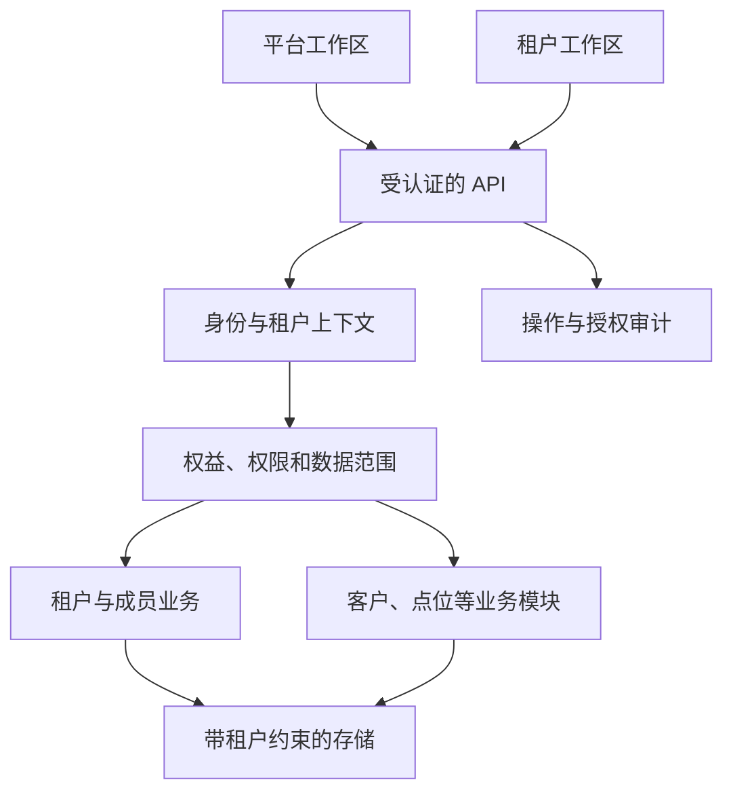

# 全局架构设计

状态：`proposed`。该文档描述目标边界，不描述已经存在的服务。

## 1. 产品与技术分层

建议先使用一个前端应用和一个 Go 模块化后端。平台运营与租户使用者共享必要基础能力，使用独立权限域和工作界面。先把租户、模块开通、成员与权限做成一个完整闭环，再逐步接入经营业务。



两个工作区可以先属于同一前端构建，但这不构成安全隔离。后端必须针对每个操作验证权限域与资源范围。

## 2. 能力所有权

| 能力 | 负责什么 | 不应混入的责任 |
| --- | --- | --- |
| Identity | 账户、登录、会话、认证提供方 | 租户套餐是否开通 |
| Tenancy | 租户生命周期、成员关系、租户上下文 | 菜单组件导入 |
| Entitlements | 租户有效模块、额度、时段 | 成员角色和具体资源授权 |
| Access | 动作权限、数据范围、授权决定 | 报价与扣费 |
| Navigation | 已构建页面的导航与可见性 | 任意远程代码执行、最终 API 授权 |
| Preferences | 用户语言、外观与允许覆盖的租户品牌 | 权限和业务状态 |
| Audit | 操作者、租户、目标、操作结果、关联 ID | 把未完成操作记录为成功 |
| Domain modules | 客户、点位、设备、服务等业务规则 | 各自再造身份和租户系统 |

“租户模块已开通”“成员有某个动作权限”“资源属于允许的数据范围”是独立条件。菜单树只是授权结果的表现之一。

## 3. 四类核心对象

| 对象 | 示例 | 关键约束 |
| --- | --- | --- |
| 用户 | 某员工的全局账户 | 账户可关联多个租户，不共享各租户角色 |
| 租户成员 | 用户在租户 A 的成员关系 | 有独立状态、角色与数据范围 |
| 租户权益 | A 已开通客户管理，到某日期有效 | 生效权益与套餐目录分开，不以菜单是否显示判断 |
| 业务资源 | 客户、点位、设备、合同 | 具有明确租户归属和资源状态 |

跨租户合作、经销/服务/租赁等经营身份，后续建为业务关系与授权范围，不直接等同于系统安全角色。

## 4. 访问机制

对于租户内某项业务动作，建议服务端执行：

```text
允许执行 = 有效会话
        AND 有效租户/成员关系
        AND 本动作要求的模块权益有效
        AND 存在允许本动作且覆盖本资源范围的有效授权
        AND 资源状态允许本次操作
```

这是不同约束之间的交集。多个角色可按策略合并授权，同一动作的范围可以按策略扩大，但必须保留动作与范围的绑定，不能扩大租户权益，也不能把读取全部资源的范围套用到仅允许修改部分资源的权限上。未订阅租户仍需可访问企业设置、已授权的开通入口等基础能力；它们不被不存在的业务模块权益锁死。

平台操作单独判断平台权限、目标租户范围与审计要求。默认不给平台身份隐含的租户业务访问权。

完整语义、示例和恢复策略见 [Access Context](../contracts/access-context.md)。

## 5. 技术建议与未决项

| 项目 | 建议 | 当前承诺范围 |
| --- | --- | --- |
| 前端 | Vue 3 + Vben 5 + Ant Design Vue + TypeScript | 推荐草案；未导入依赖 |
| 组织方式 | 单一 console 应用，必要上游包，后端动态菜单 | 不承诺任意切换组件库无成本 |
| 后端 | Go 模块化单体 | Web 框架尚未选择 |
| 数据库 | 优先评估 PostgreSQL 的事务与租户约束 | 未建立数据库，无容量实测 |
| HTTP 契约 | OpenAPI 作为结构源；生成 TS 类型 | 目前只有语义设计，无已发布接口 |
| 认证 | 浏览器首期优先同源会话，写操作明确 CSRF；保留认证提供方适配 | 在 S02 固定 ADR 并实现，不能直接沿用演示凭据 |
| 事件 | 先用明确事务边界，必要时加 outbox | 不预先堆入分布式消息系统 |
| SaaS 起点 | 平台开通租户模块 → 成员获得相应权限 | 首期人工授权开通作为推荐；没有真实支付承诺 |

## 6. 与已有系统的关系

本轮只核验 `cs-biz`。没有读取或迁移其他业务仓库，所以不能断言旧实现已被替代、某个历史 Issue 已解决，或旧数据可直接迁移。

在启动迁移前，需要给每项资产记录来源仓库、固定提交、契约与数据兼容要求，区分复用、适配、重写和保留。重建前端骨架不能自动修复业务闭环缺失；应通过 [SAAS-01 用户旅程](../journeys/SAAS-01-tenant-onboarding.md) 证明新系统兑现了结果。
