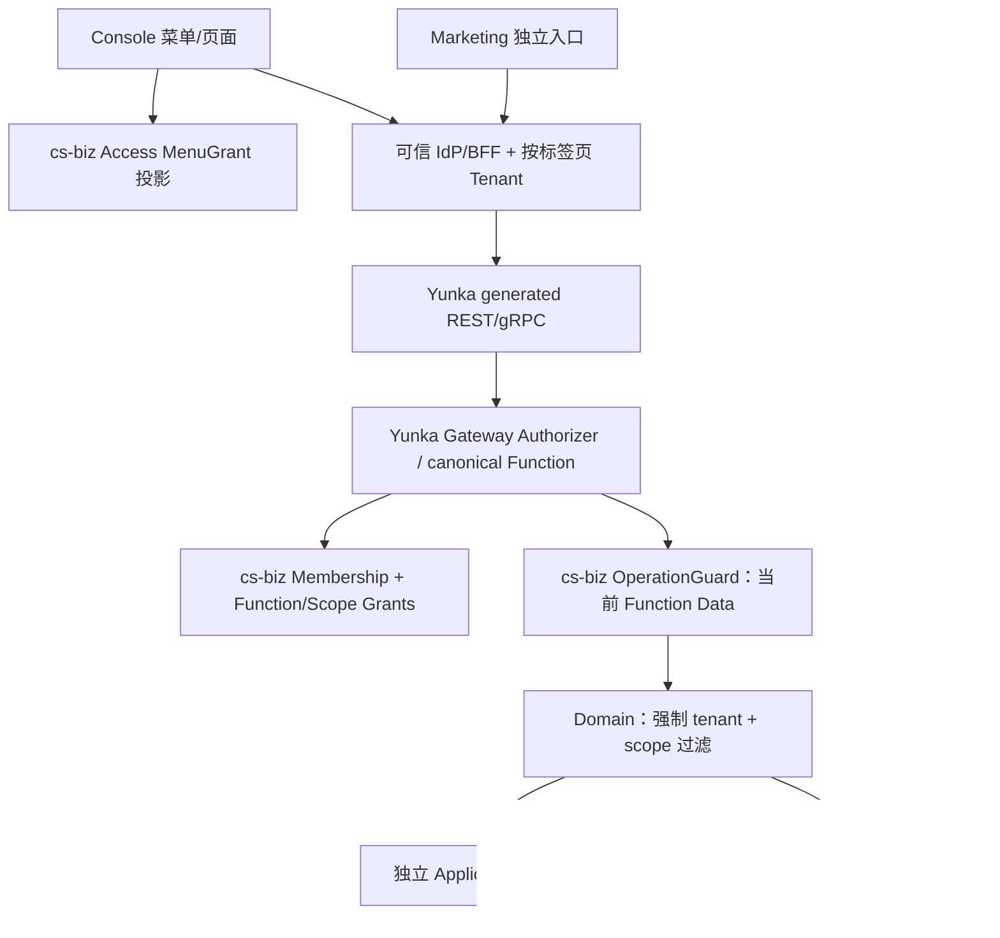

# 全局架构设计（当前基线与 Yunka 目标）

## 事实与目标不可混同

- **当前 main 已实现**：Vue 3/Vben Admin 5/Element Plus 桌面端与本地 S01 Mock、纯 Go 1.23 `backend/internal/platform/authz` Operation 授权基础库。真实 IdP、BFF、IAM Store、业务 REST/SQL、Yunka Runtime **未实现**。
- **尚未合并候选**：[PR #7](https://github.com/hvritual/cs-biz/pull/7) 身份/企业选择、[PR #8](https://github.com/hvritual/cs-biz/pull/8) Menu/Function/Data 三权和营销无后台准入；有其独立版本 CI，不能算 main 事实。
- **下一阶段目标**：有条件导入 Yunka（[ADR-0002](adr/0002-yunka-runtime-adoption.md)），使用 typed Protobuf/OperationPlan/Gateway/OperationGuard/Executor/Assembly 的**单一执行路径**，保留 cs-biz Access/Domain 为真实业务权威。[主线 #10](https://github.com/hvritual/cs-biz/issues/10)。

## 架构层次

以上为**目标图**；当前 Go V2 是独立的内核单测实现，尚未有真实服务入口。更详见 [Yunka 目标架构](yunka-access-runtime.md)。

## 单一责任表

| Owner | 负责 | 不负责 |
| --- | --- | --- |
| IdP/BFF | Account 凭据、受信 Session、每标签页 Tenant、CSRF 与撤销 | 通过客户端 ID 宣称身份 |
| cs-biz Tenancy/Access | Tenant/Membership/Role、MenuGrants、实际 Permission+Scope Grants | 自造第二个通用 Operation Executor |
| Console/Marketing | Menu 路由与 Function 按钮、Data Scope 展示 | API 最终授权 |
| Yunka PB/Compiler | Operation、Permission/ALL-ANY、Auth、Transport、ExecutionPolicy 的唯一可写合同及派生产物 | 客户 SQL、浏览器菜单与业务状态 |
| Yunka Gateway Authz | 当前 Function 的一次授权，消费 cs-biz GrantResolver | Role/Menu 的另一套 DB |
| cs-biz OperationGuard | 从当前授权 Grants 解释业务数据范围，注入可信 Scope | 伪造 Principal、替 Domain 执行安全 SQL |
| cs-biz Domain | 资源所有权、强制 Tenant+Scope SQL、状态、模块可用性、回执/审计 | 重复计算角色 Permission |
| Yunka Executor/ExecutionScope | 统一 Operation 调度、显式事务/幂等、Root UoW | 自动替业务提供 OTP/短信/响应回放 |

## 核心三权语义

`MenuGrant` = Console 页面可见；`Function Permission` = 受保护 Operation 的功能可用；`Data Scope` = 该 Permission 的数据可见/可写范围。菜单不成为 API 判定项。有营销 Function、无 Console 菜单的普通成员可使用营销，但不可进入后台；有 Menu、无 Function 的成员不能直调受保护 API。不同 Function 的 Scope 不得交叉扩权，`group` 语义另需真实领域证据。

未来结构合同见 [Access V3](../contracts/three-rights-v3.md)，先前 [Access Context](../contracts/access-context.md) 的会话/失败/幂等规则继续保留；如早期“OpenAPI 自己作为可写源”与本方向冲突，以 typed PB 作为目标 Operation 合同源。

## 工程边界与条件

首选 Go 模块化应用与真实关系型数据库，但固定 Yunka 版本、DB、IdP、TLS/Session TTL、Audience/Worker 与资源策略仍需 F0–F3 冻结。当前没有生产发布。Go 工具链预计从 1.23 升到 Yunka 锁定 Go 1.25.13、protoc 3.21.12，并且必须独立 Consumer 编译/依赖/生成测试才能宣称兼容。

阅读：[F0–F6](../tasks/YUNKA-MIGRATION-F0-F6.md)、[权限定义 SOP](../tasks/YUNKA-DEVELOPER-PERMISSION-FLOW.md)、[SAAS-01](../journeys/SAAS-01-tenant-onboarding.md)、[MKT-01](../journeys/MKT-01-function-without-console.md)。
