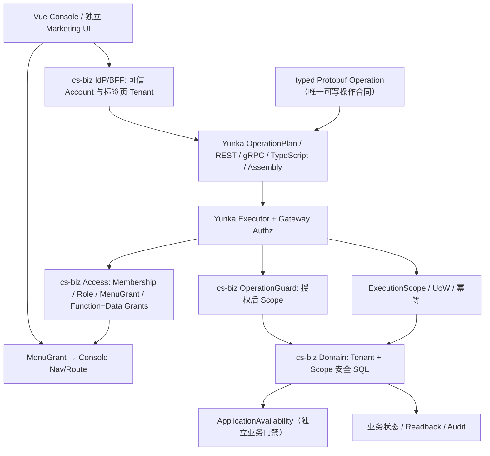
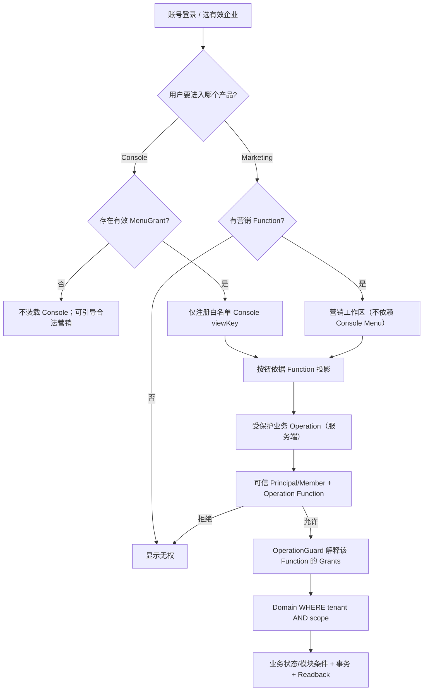

# cs-biz × Yunka 三权执行架构（目标设计）

> 状态：**target / not implemented**。当前 `main` 尚不包含 Yunka 消费运行时。采用方向 [ADR-0002](adr/0002-yunka-runtime-adoption.md)，路线 [#10](https://github.com/hvritual/cs-biz/issues/10)，当前代码边界见 [后端 V2](../../backend/doc/AUTHORIZATION-V2.md)。

## 1. 系统和权限权威

`Yunka` 只持有**授权执行机制**，不拥有 cs-biz 菜单、角色事实、客户/点位/设备业务范围或可用模块目录。Yunka 的 `identity.Principal` 必须由服务端完成真实凭据验证，Account/Platform/Service/Worker → Principal 是经评审的显式适配，不从客户端自由字段推断。

## 2. 不可混淆的两条路径

后台登录准入是前端产品入口行为，不代表该用户不能认证；**业务 HTTP/gRPC 授权不能读 MenuGrant**。只有菜单没有客户读取 Function 时允许呈现菜单及受控空状态，但必须拒绝后台直调读取 API。对能使用营销的成员，不能绕 Console 开放后台菜单。

## 3. Scope 与多 Permission

- `Grant` 永远保留 `Permission ↔ Scope` 绑定；`Read` 与 `Update` 的 Scope 分别独立，`ModeAll` 的资源允许集合取安全交集，`ModeAny` 按获得的有效 Permission 的资源谓词安全合并。
- 数据范围由 cs-biz 实现解释：`tenant`、`self`、`assigned`、`explicit` 为拟定业务通用策略；`group` 是 S01 Mock 的**同部门范围**，需要独立业务事实、子集语义与数据库实现，不得隐式变成 `assigned` 或 `tenant`。
- `gateway/authz.GrantResolver` 是从 cs-biz Access 持久事实解析**当前 Operation 所需** Grants 的适配层；不使用 `gateway/dispatcher/intercept/role` 的 legacy DB 创建平行授权权威。
- `OperationGuard.Prepare` 接收已授权 Operation+Decision，绑定作用于当前租户和 Function 的类型化 Scope。框架 `ScopeKey` 只是数据传输 API，不是一张自行签发的权限票。
- `Domain/Repository` 在查询、分页、统计、导出、写入、批量和资源状态变化时执行强制数据库谓词。不能先查整个租户再对浏览器可见行过滤。
- `ApplicationAvailability` 独立处理“营销模块未开通”，保持 IAM Function Grant 不变，不能在权限定义时把商业 Plan/Subscription 加入 Gateway 核心。

## 4. 运行执行、事务与跨端

- Typed Protobuf 是 Operation、Permission、transport、事务/幂等 policy 的唯一可写合同；Yunka 编译产生 OperationPlan、OpenAPI、TS Client、REST/gRPC Adapter、AssemblyPlan 等派生工件。
- `framework/operation.Executor` 是统一执行路径；root `ExecutionScope` 负责 UoW/事务/持久幂等；子操作加入同一 root UoW，不隐式再开事务。
- 服务端授权属于 Gateway 统一受保护执行边界。Domain 只处理已授权 Scope 的资源过滤及业务不变量，不重复对角色权限进行 `Authorize`。
- 原 cs-biz `internal/platform/authz` 保留当前代码与测试作为基线，F2 迁移一条 Operation 时要确保实际只通过一个生产授权入口；F5 全量覆盖与回滚验证后才移除旧 `HTTPRouter`。
- 业务 `operation_id`、审计和失联回执恢复由 cs-biz Domain 定义；Yunka 已有幂等**重复执行抑制**不自动等价于同键读回原始响应。

## 5. 依赖与发布边界

Go 1.23（当前后端）→ Yunka 工具链 Go 1.25.13 / protoc 3.21.12 是**需要独立证明**的消费者升级；锁定 Framework/Gateway/Infra 模块版本和安全补丁，不直接消费浮动 main。PR #7/#8 未合并，不能把其候选文件当作当前 main。无真实数据库、IdP/BFF、可信 Scope SQL 和实际消费者 E2E 之前，不能宣称 SaaS 权限真实运行完成。

完整开发 SOP：[Yunka Permission Flow](../tasks/YUNKA-DEVELOPER-PERMISSION-FLOW.md)。
