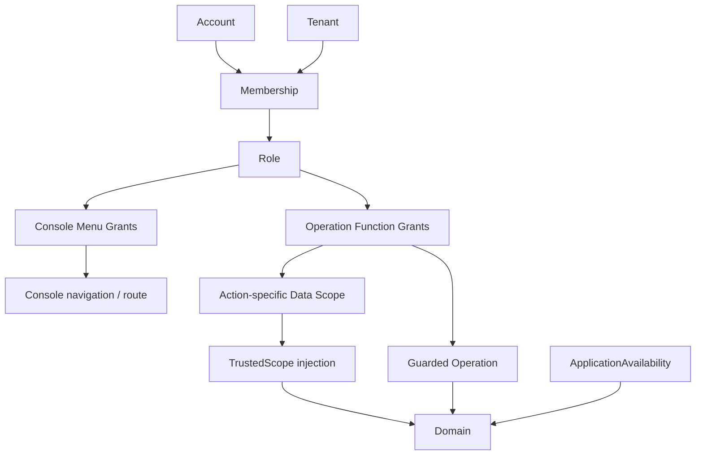
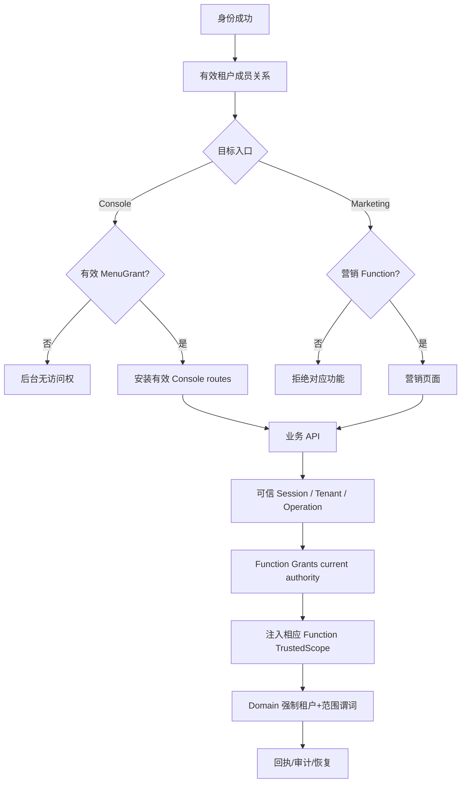

# 三权分离：cs-biz Access 设计与实现合同 V2.2

状态：**S01 + PR #7 身份切片上的 V2.2 本地数据与 Go Kernel 集成**；真实 IdP、BFF、持久化 Access 及 SQL Adapter 尚未交付。来源：仓库 `doc/contracts/access-context.md`、`backend/doc/AUTHORIZATION-V2.md`、V2.2 设计附件。

## 不可违反的权限边界

- **MenuGrant**：独立 Console 路由白名单，控制后台 Page/Route/Navigation。菜单授予不产生任何 Function Grant；无有效 Console 菜单，不允许装载后台壳层，但不应使账号登录失败。
- **FunctionGrant**：已注册 Operation 所需 Permission，控制按钮与每个受保护 API 的功能授权；后端不得再次做 MenuGrant 检查。
- **DataGrant**：每个 Function 的 Scope，定义请求数据域；前端展示可信快照，后端 `Decision.InjectDataScope(ctx)` 生成 `TrustedScope`，业务 Domain 将可信 tenant 与该 Function Scope 编译为查询、更新、聚合、导出条件。
- **产品模块**：独立的 ApplicationAvailability 领域，不得自动赋予 Menu/Function/Data 权利；模块关闭，IAM Grants 不修改。
- **主体类型**：Platform/Human/Service/Worker/Public，Platform 不继承企业身份；同 Account 跨 Tenant 的 Role/Menu/Scope 独立。

## V2.2 模型

UI 临时类型：`Role.menuGrants: ConsoleMenuKey[]` 与 `Role.grants: {action,scope}[]`；`AccessContext.menuGrants`/`permissions`/`dataScopes`/`navigation` 共同来自同一访问版本。保留旧 S01 `grant.scope = all / group / own` 用于预览，**不得**将 group 默默映射到 Go V2 的 assigned、tenant。Go 后端权威 Scope 是 tenant/self/assigned/explicit；group 的真实查询语义需另立场景和验收。

独立演示操作 `marketing.campaign.read`、`marketing.campaign.execute` 以 `marketing` 模块为业务可用性前提；营销本身不是 Console 菜单。S01 Mock API 已支持读取本人活动和按幂等键执行活动；真实营销 Domain 及持久授权服务待实现。

## Console 与业务 API 授权

后端不能因角色缺少菜单而禁止已授权营销 API；也不能因为有菜单就放行功能 API。对于数据列表，业务仓储必须强制 `tenant_id` 和该函数的 `scope`，而不仅在内存中过滤分页结果。对于写入，请在有真实事务时使用受保护 WHERE 条件并提交前重验。

## Role 编辑与旧数据

- 三列：菜单 Switch 独立管理 `menuGrants`，Function Checkbox 独立管理 `grants.action`，每个 Action 的 Scope Radio 独立修改其 `grants.scope`。
- 打开菜单不会自动授予 Read；关闭菜单不会删除 Function；调整 Read Scope 不能改变 Update Scope。
- `marketing.functions` 只是权限集编辑器里的**分组**，不属于合法 Console MenuGrant。
- 更新前本地 S01 历史角色缺少 `menuGrants` 时，仅在旧数据读取边界通过先前能够显示的 Read Grant 恢复旧菜单，以保留旧工作区可见性；**新建角色永不从 Function 推断菜单**。真正持久 DB 迁移需单独审批和回读。
- 前端投影非安全凭据，浏览器仅用于展示；生产安全边界仍是经验证的身份上下文＋操作权限＋业务查询限制。

## 最低验收

MKT-01 营销有 Function 无后台 Menu；CON-01 Menu 有而 Read 无不可直调；CON-02 同菜单 Read=tenant Update=self；TEN-01 跨租户隔离；SCP-01 group 不能被错误扩大；MOD-01 模块关停只影响业务可用性；REV-01 当前 Function 重读；REC-01 操作 lost reply 保持幂等。

验收分层：本 PR 前端 Vitest/Playwright + Go authz 决策，**不等于**真实 IAM/DB/IdP/API 安全完成。真实交付还需通过存储并发、HTTP 直调、SQL Tenant+Scope、跨标签会话和审计恢复验收。
