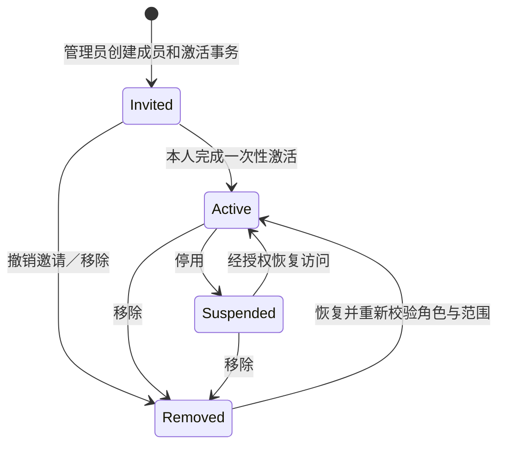

# ID-01｜企业成员全生命周期（cs-biz V1）

> 状态：**目标旅程与第一切片实现**。基线 `main@af021df9721d745920d4147763e895c982ee601d`；源旅程为 `hvritual/biz@a8a2368f03d8f8ce53d6adcb431fb3ba55df1184` 的 Account/Membership、邀请激活、停用/恢复、安全回读方法。**未迁移原仓库运行代码或商业授权体系。**
>
> 证据分类：`EXISTING`=cs-biz 当前 main；`SLICE`=本 PR 内候选；`DESIGN`=需要实现；`EXTERNAL`=需要真实通道/生产环境；以上不互相证明。

## 1. 用户目标、非目标与权威

**目标：** 企业 Owner 能邀请真实员工，员工本人安全完成激活并登录，选择其有权进入的企业，取得严格受限的菜单、动作和客户数据；人员离职、权限调整、删除/恢复后，新请求立即符合当前事实，且操作可回读、失败可恢复。

**非目标：** C 端扫码饮品用户、平台租户管理员继承全部租户角色、企业 SSO/LDAP/SAML、商业套餐/支付、从 `hvritual/biz` 搬运数据库实现、发不出去却报告“邀请已送达”。

| 事实 | cs-biz 权威责任 | 不允许 |
|---|---|---|
| `Account`/凭据 | 新建 `backend/internal/access` 的持久身份领域 + 经认可的 IdP | 用 S01 `api.selectUser(id)` 登录生产 |
| `Membership` | Access：`(tenant_id, account_id)` 唯一，四态 `invited/active/suspended/removed` | 单租户“停用”影响别的企业共享账号 |
| `Profile` | Access 租户成员 Profile + 全局 Account 联系标识分别管理 | 用一列电话号码充当全局主键又当企业联系人 |
| `Role/Grant/Scope` | Access 持久记录，`backend/internal/platform/authz` 只负责受保护 Operation 当前授权 | 客户端拼 `tenantId`、菜单或角色名当权威 |
| `Tenant/ModuleAvailability` | 租户领域与未来独立应用开通领域 | 租户应用开通自动给予用户 IAM Grant |
| `Session/WorkspaceContext` | BFF + Access 验证当前会话/已选择企业（按浏览器标签页隔离） | 复制 Biz 的全局 active-tenant cookie/广播覆盖各标签页 |

现状：S01 `MembershipStatus='active'|'disabled'`；`createMember` 会同步建立 `active` 本地数据；没有真实账号验证、密钥、邮件/SMS、MySQL、邀请发送或后端 API。禁止将其改名为“已邀请成功”。

## 2. 产品角色

| 角色 | 任务 | 准入 |
|---|---|---|
| 平台运营 | 建租户、管理模块申请/开通 | 独立平台 Audience；不等于租户 Owner |
| 企业 Owner | 新增/邀请成员、查看进度、分配权限、停用、恢复、维护最后 Owner | 真实企业 Membership + 当前 Grant + Owner 不变量 |
| 企业管理员 | 在获授权范围内管理其他成员 | 不可直接旋转其全局 Account 密码 |
| 普通成员 | 激活、自助登录、完成授权业务、修改个人资料 | 有效账号+有效企业关系+业务权限+资源范围 |
| 被停用/移除账号 | 重新登录其他企业或申请恢复 | 不得访问已撤权的企业数据；有明确下一步 |

## 3. 生命周期不等于单个状态字段



`Account.active` 与 `Membership.status`、激活票据状态、`Session.revoked`、当前权限集合分别独立。在线/离线、密码重置、角色编辑都**不是** Membership 新状态。

| 当前 | 动作 | 目标 | 关键守卫 | 提交/回读 |
|---|---|---|---|---|
| 不存在 | 创建/邀请 | invited | 当前可用 Tenant、操作者有 `tenant.member.create`、角色属于本企业、唯一账号关联合法、成员额度适用时校验 | 持久关系 + 受保护通知 Outbox；只可显示“邀请待送达” |
| invited | 本人激活 | active | 一次性、未到期、绑定 tenant/account 的激活凭证 + 密码政策/本人验证 | 原子消费凭证 + 状态版本更新；独立读取 Membership |
| active | 修改资料/角色/范围 | active | CAS、当前授权、Role Grants 独立 scope、资源租户一致 | 回读新的 Profile/Grant/Scope，刷新有效菜单 |
| active | 暂停访问 | suspended | 需要原因；不允许自停用、不能停最后 Owner、版本符合 | 原子撤销当前租户工作区会话；不动 B 企业成员/凭据 |
| suspended | 恢复访问 | active | 授权、CAS、当前角色/数据范围合法 | 新请求可重新登录；**被撤销的旧 Session 不复活** |
| invited/active/suspended | 移除 | removed | 同上 + 保留/删除数据政策；审计 | 不再占用“active 成员”；具体商业配额另由额度权威定义 |
| removed | 恢复 | active | 有明确恢复授权、CAS、重新评估旧角色/对象范围，必要时重新邀请 | 新的授权回读、重新登录；不能重放旧权限快照 |
| 任意非法状态 | 变更 | 不变 | CAS/冲突/资源不存在/权限变化 | 有稳定错误码，不允许 HTTP 200 伪成功 |

Go 第一切片：`backend/internal/access/identity/journey.go` 已表达 0/1/N 入口、成员状态迁移、CAS/Owner 保护和会话拒绝纯逻辑；只有 Go 测试 Fake，没有真实存储、账号密码或 Session 服务。建议持久 `Membership` 的 `version`、`status` 与旧工作区会话撤销、审计、Outbox **同一数据库事务**；此声明目前是 `DESIGN`。

## 4. 页面/操作旅程（每一步都有 Result + Recovery）

| Screen ID | 入口/用户任务 | 用户必须看见 | 后端执行与失败恢复 | 状态 |
|---|---|---|---|---|
| M01 | 企业中心→成员管理 | 当前企业/成员数/状态筛选/额度如有可信口径 | GET 当前 Tenant 成员，资源读权限 | EXISTING Mock |
| M02 | 选择“添加/邀请成员” | 用户名、姓名、至少一种联系方式、部门、激活方式 | 不可伪造无关外部通道；先确认 Account/成员重用语义 | EXISTING 双步向导；激活方式 DESIGN |
| M03 | 选择权限集 | 套用现有权限集或新建，明确 action×scope | 当前 Owner 的委派上限；不允许选择跨 Tenant Role；写操作 CAS/幂等 | EXISTING Mock |
| M04 | 核对创建影响并提交 | 企业、人员、角色、数据范围、邀请到达方式 | `member.create` + 唯一幂等键，超时先查询结果不可重复建号 | 部分 Mock；后端 DESIGN |
| M05 | 创建回执 | 成员 `invited`、通知 `queued/sent/failed` 区分、目标脱敏、下一步 | receipt + readback；邮件/SMS 有真实 provider 时才标注送达 | DESIGN/EXTERNAL |
| M06 | 成员本人激活 | 企业名称、被邀请身份、设密（链接）或初始密修改（SMS） | 一次性绑定码/失效重发；保留其它租户全局凭据 | DESIGN |
| M07 | 首次登录/选企业 | 身份认证成功后的企业选择，0/1/N | 依赖 [ID-02](ID-02-login-workspace.md)，角色准入后进入业务 | 本 PR 选择页 SLICE |
| M08 | 成员右侧详情 | 资料、权限摘要、范围、最近活动；查看不等于勾选 | 当前成员 Readback 与 CAS | EXISTING Mock |
| M09 | 停用成员 | 操作对象、企业、影响范围、原因与确认 | 拒绝停最后 Owner/自停、事务撤销当前租户会话 | EXISTING Mock 部分；后端纯决策 SLICE |
| M10 | 恢复/移除/回收 | 是否可恢复、将重新计算的权限、结果确认 | 角色有效性、范围重验；旧 Session 不复活 | DESIGN |
| M11 | 个人找回/修改密码 | 不显示凭据；通过本人验证 | 全局密码变更撤销 Account 所有会话；不能由租户管理员代设 | DESIGN |
| M12 | 本人退出企业 | 明确“退出当前企业”而不是全局销号，最后 Owner 不得退出 | 本人核验、撤销该租户访问，保留其他租户 Account | DESIGN |

## 5. 关键业务逻辑

### 创建和激活

```text
Actor + Tenant + Operation + Grants 校验
  → Account 查找/创建（有唯一性与保护信息）
  → 按 tenant 建立 invited Membership
  → 绑定权限集、部门、显式数据范围（独立当前状态）
  → 写入 activation challenge + 受保护 outbox + audit
  → commit → 收到已受理回执
  → 投递 worker 异步发给本人
  → 本人凭码自证 → challenge 一次性消费
  → Membership active + receipt + readback
  → 前端进入登录/选企业而不是直接冒用身份
```

*受限登录标识*：用户名/全局邮箱需要由唯一 Account 解析；手机号可能存在多个 Tenant Profile，不能据此任选一人。没有唯一可证身份就拒绝认证，且失败文案不允许枚举“该手机号属于哪些企业”。联系方式明文、密码、验证码、Activation URL 不进入普通业务回执、前端存储或日志。参考 Biz 的两种激活途径是**适配设计**，不是 cs-biz 已有发信能力。

### 授权和模块开通

```text
Authenticated account
  ∧ selected and currently active tenant Membership
  ∧ canonical Operation permitted by current IAM Grant+its Scope
  ∧ Tenant ModuleAvailability (only when operation requires it)
  ∧ Domain-owned Resource/Tenant/State/Quota invariants
  → Action allowed
```

`backend/internal/platform/authz` 已拥有 `Operation Registry`/`Authorize`/`HTTPRouter`。**禁止建立第二套授权引擎**。模块启用是业务条件，与 IAM 不耦合；没有权益 ≠ 没有角色权限。将不同 action 的读全量 Scope 和写本人 Scope 混为全量写是非法的。

### 停用、删除、恢复

在权限与正确当前版本校验后，更新租户 Membership，**事务内**执行相应租户工作区撤权、审计及状态事件；只撤目标租户的上下文，其他企业会话/全局 Account 不受影响。对受影响的进行中写请求，需要提交前再次验证不变量。恢复必须新建合格 Session/WorkspaceContext，已撤销会话永不可复活。

## 6. 原 Biz 旅程的适配与不照搬

| 原 Biz 合同 | cs-biz 决定 | 原因 |
|---|---|---|
| 全球 Account / Tenant Membership / Profile 分离 | **保留语义** | 已有 `User`/`Membership` 初步形状可升级 |
| 四态成员和最后 Owner 保护 | **目标升级**，保持 S01 active/disabled 演示兼容直到接口迁移 | 现有前端没有安全激活、删除和真实会话 |
| 独立 `Authorization Code + PKCE`、BFF 会话 | **建议复用标准**，但认证供应端/DB 当前没有 | 不能造 Mock 密码称作真实登录 |
| Biz 全局 BFF `active_tenant_id`，切企业广播全标签页 | **不照搬** | cs-biz 已明确标签页独立企业工作区，详见 ID-02 |
| Biz Commercial Plan/Entitlement Guard | **不移植内核** | cs-biz authz V2 有意商业独立，应用可用性由另一个领域承担 |
| Biz 密码 5次/15分钟、TTL、OTP 限额 | **不作为已批准政策** | 来源决策账本仍有 Pending Human，见 ID-02 |
| Biz 菜单/成员视觉 | 继承 cs-biz **Desktop UI Contract** | 全局壳层/Token 已冻结，禁止换 UI 框架 |

## 7. 异常状态与可执行恢复

| 情形 | 用户反馈 | 下一步 |
|---|---|---|
| `IDENTIFIER_AMBIGUOUS`（仅服务器内部） | 账号或凭据不正确 | 使用另一标识/安全找回，避免枚举 |
| `ACTIVATION_EXPIRED` | 激活链接已失效 | 有权管理员重新发起激活 |
| `MEMBER_INVITED` | 邀请尚未完成 | 查看可信投递状态/重新发送 |
| `MEMBER_SUSPENDED` | 当前企业已暂停你的访问 | 切换其他企业/申请恢复 |
| `LAST_OWNER` | 当前成员是企业唯一负责人 | 先设置另一有效负责人 |
| `VERSION_CONFLICT` | 成员已被其他操作修改 | 重新读取，核对后再操作 |
| `MODULE_INACTIVE` | 当前企业未开通对应功能 | 请求开通或联系负责人，不能伪报无角色权限 |
| `RESULT_UNKNOWN` | 结果还需核对 | 用同一操作标识 readback，禁止生成第二次副作用 |
| `DELIVERY_UNAVAILABLE` | 暂时无法发送激活通知 | 保留 invited 事实，并提供管理员操作/真实通道状态 |

## 8. 验收与 Done Gate

以 `Actor/Object/Understand/Action/Result/Recovery` 六项为用户完成条件，每个写任务须有稳定 `operation_id`、幂等/CAS、审计、真实状态回读。以下全部要求独立证据：

- 激活链接消费一次，过期/重放拒绝；无已批准真实 provider 不显示“已送达”；
- 双租户共享 Account：A 停用/移除/恢复不更改 B 的成员关系、会话和凭据；
- 同时停止最后 Owner 与另一个 Owner：数据库级并发保护成立；
- 更新权限/模块后下个敏感请求拒绝；列表、详情、写入、导出范围分别验证；
- 角色与成员状态变更的 Lost Reply 不造成重复提交；快照不冒充提交；
- 当前迭代的 Go 单测 + 本地 Mock Playwright **不能**作为实际身份/数据库/邮件认证通过的证据。

**阶段入口和允许路径：** [任务分解](../tasks/S02-identity-journeys.md)。设计限制：[Desktop UI Contract](../design/desktop-ui.md)。
