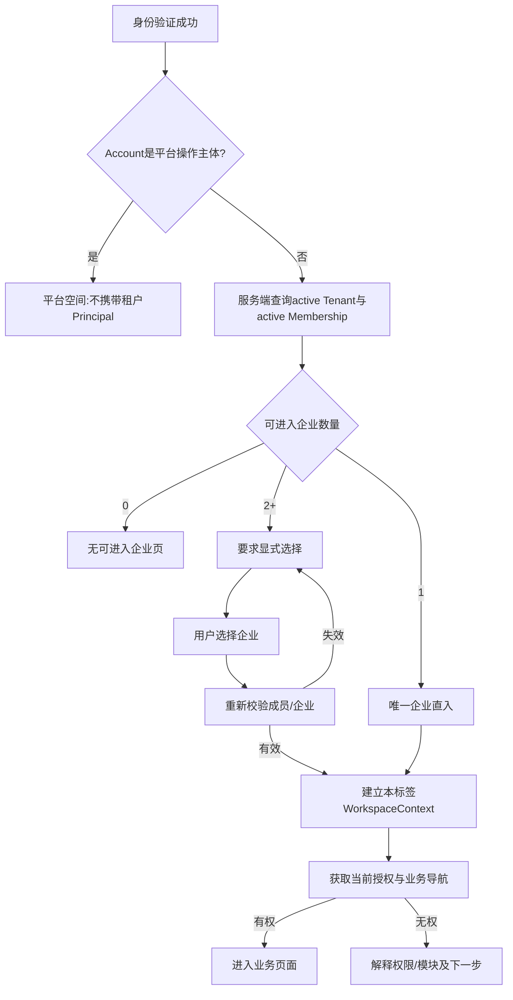
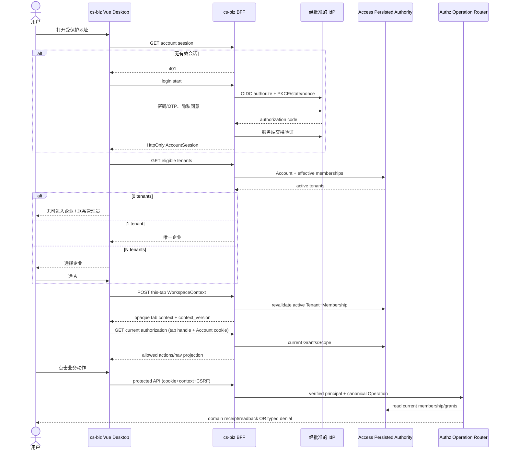

# ID-02｜登录、企业选择与安全会话旅程（cs-biz V1）

> 来源：`hvritual/biz` 用户登录旅程（2026-10-14）和 `hvritual/cs-biz main@af021df9721d745920d4147763e895c982ee601d`。本轮区分 `EXISTING`（S01 Mock）、`SLICE`（本 PR 前端选择页/纯 Go 决策）、`DESIGN`（真实登录）及 `NEEDS_INPUT`（外部身份、短信/邮件与产品安全参数）。

## 1. 必须达成的用户结果

```text
AccountVerified
  + RequiredPrivacyConsentRecorded
  + BrowserSessionIssued
  + (PlatformActor OR TabWorkspaceTenantSelected)
  + FreshMembership + FreshGrant + AppAvailability + ResourceScope
  + TargetRouteAuthorized
  => BusinessWorkspaceReady
```

**认证成功 ≠ 已经选定企业 ≠ 企业已开通模块 ≠ 某用户有操作权限。** 用户能在失败后知道原因与下一步；回到登录前可信的内部目标页面；不会看到上一个企业或别的标签页的旧数据。

## 2. 与 Biz 的关键差异：标签页独立企业，不复制全局切换会话

Biz 当前 BFF Session 持有单个 `active_tenant_id`，切企业旋转上下文/CSRF 并通知其他标签页。**cs-biz 现有 Access Context 合同明确每个标签页独立选择企业，两个标签页允许同一 Account 分别进入 A/B。**

正确逻辑应分成两层：

| 层 | 权威/位置 | 变化后的影响 |
|---|---|---|
| `AccountSession` | 后端受保护的全局账户会话；浏览器仅持 `HttpOnly;Secure;SameSite` Cookie | 退出整个账号/全局密码安全事件撤销全部绑定工作区 |
| `TabWorkspaceContext` | 服务器校验过的 `(session_id, tenant_id, context_version)`；每个标签页独立持无授权能力的 opaque handle | A 标签切换企业不改 B 标签当前企业；每次 API 重新检验 Membership/Grant；被撤权时目标企业的上下文失效 |
| `CurrentAuthorization` | Access 当前权限记录与领域状态 | 任何敏感 API 必须重新准入，不允许旧路由权限继续放行 |
| `Theme/Locale/Navigation` | 租户/个人适配投影，前端只展示 | 切企业清缓存并重拉，不能反向改变权限 |

建议协议：在账户 HttpOnly Cookie 基础上，每标签页保存一个**不可自我签发权限**的随机 Workspace handle（存内存或标签页 `sessionStorage`），通过受保护同源 API 传送；服务器保存/签名并验证其 Session 归属、tenant 绑定、失效时间、context_version。请求 body/header 中的任意 tenant ID **只是待校验的请求参数**，不能单独作为权威。安全敏感命令使用 CSRF 与 stable idempotency key。账号级撤销可唤醒各标签页清理；不能像 Biz 那样因 A 标签切企业就悄悄切换 B 的操作目标。

**该层尚未实现。** 当前 S01 `sessionStorage` 的预选 User ID、tenantId 是浏览器演示数据，不是受信 session。

## 3. 页面与用户行为

| ID | 页面/触发 | 界面信息及操作 | 后端边界 | 状态 |
|---|---|---|---|---|
| L01 | 受保护深链接 | 先探查已有 Account Session；回跳目标须安全 | 未认证 401；`return_to` 仅同源安全路径 | DESIGN |
| L02 | 正式账号密码登录 | 账号/邮箱/适合的手机号、密码、找回入口，防枚举 | IdP验证、密码锁定、防暴力枚举 | DESIGN |
| L03 | 验证码登录（适用时） | 选择可用渠道、验证码、倒计时、重发及明确错误 | OTP绑定 purpose/session/account/flow，一次性消费 | NEEDS_INPUT |
| L04 | 条款与隐私 | 版本、必须同意的目的，拒绝可退出 | 服务端持版本证明，不能以关弹窗作为接受 | DESIGN |
| L05 | 登录回跳 | “正在确认身份与企业”短态，不暴露 token | OIDC code+PKCE+state+nonce → BFF Session | DESIGN |
| L06-A | 0个有效企业 | “没有可进入企业” + 联系管理员/切换账号 | 不签发租户工作区上下文，租户 API 拒绝 | SLICE UI |
| L06-B | 1个有效企业 | 直接进入唯一企业 | 先服务端验证 active Tenant + Membership | SLICE UI 逻辑 |
| L06-C | 2个及以上企业 | 独立企业选择页，名称明确，用户主动选择 | 选择后服务端签发该标签页上下文 | SLICE UI |
| L07 | 授权菜单/初始页面 | 显示当前企业/身份、有权的菜单和对象范围 | `CurrentAuthority`→`authz.Authorize`；领域对象过滤 | EXISTING Mock + Go 内核 |
| L08 | 企业切换 | 明确选择目标企业，保留非敏感安全偏好 | 冻结原页写入→服务端新 WorkspaceContext→重载 | EXISTING Mock；真实 DESIGN |
| L09 | 退出整个账号 | 当前标签页提示；按全局撤权策略清理 | 撤销 Account Session 与所有关联上下文 | EXISTING Mock；真实 DESIGN |
| L10 | Session 失效/撤权 | 登录/其他企业/申请恢复；不可显示旧数据 | 过期 401、权限 403、旧 context 409；不自动重放写命令 | 部分 EXISTING Mock |
| L11 | 密码找回/修改 | 本人凭受控安全渠道恢复，不显示明文 | 修改全局凭据，撤销所有 Account Sessions；管理员只可邀请本人恢复 | DESIGN |
| L12 | 刷新、后退、多标签页 | A 标签页选 A、B 选 B，互不影响 | 后退/URL不能覆盖服务器当前 Workspace Authority | Mock 局部；真实 DESIGN |

### 登录后 0/1/N 的确定性规则



注意：**已有保存的 tenant ID 是偏好，不能替代选择与成员校验。** 刷新同一标签页可以恢复仍有效的已批准 Workspace handle；新的一次 Account 登录面对多企业仍应用户明确选企业。

### 本 PR 具体实现与不足

- `frontend/apps/console/src/platform/tenant-entry.ts`：0/1/N 决策；首次 S01 自动预选仅保留 preview compatibility；
- `frontend/apps/console/src/views/auth/tenants.vue`：桌面企业选择/零企业页面，不嵌入业务授权数据；
- `frontend/apps/console/src/store/workspace.ts`：主动选择账户后清旧租户偏好，未选企业无 `AccessContext`；选定才安装当前路由；原有 `RequestEpoch` 防止迟到结果污染；
- `frontend/apps/console/src/router/guard.ts`：`AuthenticatedNoTenant` 不再伪装成“未登录”，先走 `/auth/tenants`；
- `frontend/tests/e2e/workspace.spec.ts`：新增多企业与 0 企业场景，保留旧用户旅程的角色/应用数据检查；
- `backend/internal/access/identity/journey.go`：Go 的入口+成员+Session 决策函数；**不是能连接前端的真实登录服务**。

## 4. 前端/后端逻辑时序（目标设计，非当前 API）



## 5. 建议 API 契约族（待正式 OpenAPI 评审）

**这里只定义责任，不表示路由已经存在**。前后端统一由未来 `doc/contracts/openapi/` 的唯一结构源生成，而不是一份 Markdown 与 TS 各自发明接口。

| API 责任（逻辑方法，候选 URL） | 谁调用 | 返回最低要求 |
|---|---|---|
| 账号会话探针 `GET /api/v1/auth/session` | 未登录/登录后前端 | authenticated, account_id, session expiry；不含任意租户 API key |
| 可进入企业 `GET /api/v1/auth/tenants` | 已认证浏览器 | id/name/timezone + active membership proof projection |
| 选择标签工作区 `POST /api/v1/auth/workspace-context` | 已认证用户 | opaque context handle, tenant_id, context_version, expiry；CSRF；不可越界 |
| 当前授权 `GET /api/v1/auth/authorization` | 已选当前工作区 | operation/action + scope + module availability snapshot + reason |
| 退出 `POST /api/v1/auth/logout` | 已认证用户 | 完成会话撤销，不是“页面跳转就是登出” |
| 成员创建与回读 `POST/GET /api/v1/tenant/members*` | 有权管理成员 | `invited` 状态 + opaque operation receipt，Role/Membership 真实版本 |
| 激活 `POST /api/v1/auth/member-activation/complete` | 一次性受限流程 | 凭据消费与状态回读；匿名入口另须防重放/限流 |
| 本人找回 `POST /api/v1/auth/password/recovery/*` | 本人受控安全流程 | 防枚举、OTP一次消费、全局会话撤销、secretless completion |

**约束：** 所有保护操作必须在 `backend/internal/platform/authz.Registry` 注册绑定；登录/重置等 `public` 操作需声明 `PublicReason` 且经过独立安全审查；`WithVerifiedPrincipal` 只能由认证适配层调用。Tenant/Member 列表受租户 SQL 谓词保护，应用开通与 IAM 分开；若无法证明归属拒绝。

## 6. 错误与用户恢复

| 类型 | HTTP 语义（建议） | 用户应看到什么 | 下一步 |
|---|---|---|---|
| `INVALID_CREDENTIALS` | 401 | 账号或凭据不正确（防账号枚举） | 更换凭据/忘记密码 |
| `LOGIN_RATE_LIMITED` | 429 | 验证次数过多 | 在允许时间后重试/找回 |
| `CONSENT_REQUIRED` | 流程门禁 | 需要核对隐私政策 | 同意或退出，不预先勾选 |
| `TENANT_CHOICE_REQUIRED` | 会话有效但无工作区 | 请选择要进入的企业 | 显式选择 |
| `NO_ACTIVE_MEMBERSHIP` | 会话有效但无企业 | 当前没有可进入企业 | 联系企业负责人/换账号 |
| `MEMBER_SUSPENDED` | 403 | 当前企业暂时不可访问 | 切其他企业/申请恢复 |
| `SESSION_EXPIRED` | 401 | 本次登录已失效 | 重新登录并安全回跳 |
| `WORKSPACE_CONTEXT_CHANGED` | 409 | 企业身份已更新，需核对 | 重新加载当前企业授权，写命令先查状态 |
| `AUTHORIZATION_DENIED` | 403 | 当前成员没有操作权限 | 联系管理员，不伪装为模块未开通 |
| `MODULE_INACTIVE` | 403 | 企业没有开通该能力 | 企业负责人申请开通 |
| `DEPENDENCY_UNAVAILABLE` | 503 | 暂时无法确认当前身份或授权 | 保留安全的待办信息，刷新核验，不显示旧企业数据 |
| `RESULT_UNKNOWN` | 服务端状态可核验 | 操作结果待核对 | 相同 operation_id 状态检查，不能盲重试 |

### 登录和成员不可跳过的负例

- 账号密码成功但 0 个企业：只可访问“无可进入企业”及本人恢复入口，受保护业务请求均拒绝；
- 一个账号有 A/B，B 被禁用：登录应选择 A 或处理无企业，不把 B 的旧活动上下文借给 A；
- A 标签切换 A→B，另一个 A 标签/其他标签仍独立保留其已选 Workspace；必须同时被服务端按当前授权校验；
- 同一 Account 在 A 被 suspend：A 的工作区访问被撤销，B 的合法访问不被误伤；
- 管理员权限减少，页面尚未刷新：新 API 写请求仍拒绝；不能仅凭 UI 隐藏按钮作为测试通过；
- 短信/email Provider 未配置、OTP 发不出：验证码模式禁用或明确不可用；不能标记“已发送”；
- 身份回调 lost reply、重复 activation/password reset：旧 Code/OTP 单次消费，敏感写不重复，结果不确定先 readback；
- 另一个租户对象 ID 通过 URL/body/header 注入：最终资源访问拒绝，不泄漏对象存在性。

## 7. 迁移门禁和安全待决

必须由负责方提供并批准：IdP 方案与信任边界、DB及迁移方案、账号/联系方式唯一性、密码与恢复策略、OTP 时效/次数/外部 provider、隐私同意版本、Session TTL/注销作用域、撤权可见性时限、最后 Owner/删除恢复政策、审计与密钥托管方案。**来源 Biz 文档的 5 次失败/15分钟与 8小时 fallback 都不是 cs-biz 的自动产品决策。**

可用的验证层级分别为：S01 本地 Mock/浏览器、Go identity纯规则测试、Go authz 内核测试、真实 IdP+BFF 集成、真实 DB/迁移/并发/跨租户反例、真实 Provider qualification、生产故障恢复；后三级不存在时不得宣称完整登录上线。

执行计划与允许目录见 [S02 身份旅程切片](../tasks/S02-identity-journeys.md)。视觉规格依 [CoffeeLink Desktop](../design/desktop-ui.md)。
