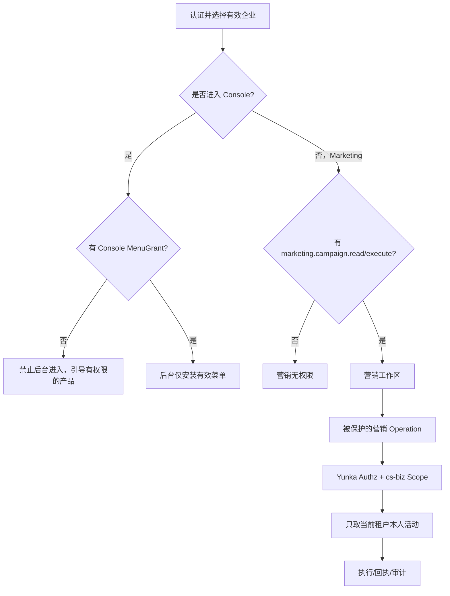

# MKT-01｜营销成员无需 Console 菜单也能使用营销

> **状态：场景已明确，PR #8 中有前端 Mock/Go 授权切片与浏览器测试；真实 IdP+BFF/Yunka Consumer/持久 IAM+DB 尚未实现。** 路线 [#13 F2](https://github.com/hvritual/cs-biz/issues/13)。

| 要素 | 业务目标 |
| --- | --- |
| Actor | Account 已验证，Tenant Membership 有效，成员只有营销 Function 与本人 Scope，Console MenuGrant 为空 |
| Object | 当前租户营销活动，含本人活动及其他负责人活动 |
| Understand | 用户看得懂“可以营销、没有管理后台权限”两种不同结果 |
| Action | 登录 → 0/1/N 选企业 → 营销页面 → 列表 → 执行本人活动 → 尝试后台深链 |
| Result | 营销被允许，后台被禁止，其他负责人或其他租户的活动 API 拒绝且无副作用 |
| Recovery | 权限变更后刷新 Scope、模块关闭提示、结果未知按 operation_id/幂等键回读，不重复执行 |

## 关键负例

1. 没有 Console Menu，但有营销 Function 时营销仍可用；任何 `/members`、`/roles`、`/customers` 的后台深链均不能装载有效后台工作区。
2. 只有客户菜单没有读取 Function 时，可见菜单不代表客户 API 访问许可。
3. `marketing.campaign.read = self`、`execute = self` 时只能读取/执行本人活动；不能以另一活动 ID、其他租户 ID/消息体等越权。
4. 模块被关闭但 IAM Grant 保留时，业务 Operation 拒绝；恢复模块后仍需要 Function 授权。
5. 角色停用/当前 Scope 收缩后新请求必须生效；对未知操作、过期 Workspace、伪造 header 无授权。
6. 幂等重试仅执行一次；如果原响应丢失，需可信 readback，不能把“正在恢复”标成“成功”。

## 权限表示

Menu = `[]`；Function = `marketing.campaign.read`、`marketing.campaign.execute`；Data = 每一 Function 的 `self`。业务模块可用性 `marketing` 另行判断。前端三栏编辑器“营销业务能力”只作为功能分组，不创造 Console MenuKey。

当前验收源：[PR #8](https://github.com/hvritual/cs-biz/pull/8) Full Gate 在其候选提交 `6d391604...` 为 20 passed、1 skipped（Desktop-only）；该测试不是持久 API／安全真实链。目标真实闭环出口见 [SOP](../tasks/YUNKA-DEVELOPER-PERMISSION-FLOW.md)。
