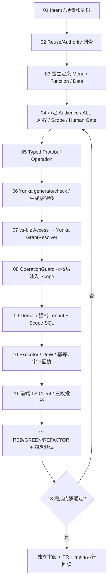

# Developer Permission Definition SOP：cs-biz 三权 + Yunka Operation

> **目标开发流程（2026-10-15）**。主线 [#10](https://github.com/hvritual/cs-biz/issues/10)，权威边界 [ADR-0002](../architecture/adr/0002-yunka-runtime-adoption.md)，三权 [Access V3](../contracts/three-rights-v3.md)。正式运行路径要等 F1–F5 接入；本 SOP 不是现有可执行 API 的说明。

## 适用范围与完成的定义

适用 Console、独立 Marketing、REST/gRPC、Service/Worker、内部子 Operation。新增功能**必须**同时证明最终用户价值、入口（Menu 是否需要）、操作（Function Permission）、资源范围（Data Scope）、当前租户与权限来源、拒绝无副作用、失败恢复。

**基本公式**：已验证的 Principal + 有效 Tenant/Membership（适用时） + Yunka Operation 所需当前 Function Grants + 当前 Function Data Scope + Domain 资源归属/状态/模块条件 + UoW/回执 = 可执行；菜单不是此 API 判定的一项。

## 开发工作流图



## 01 业务 Intent（定义对的事情）

先写 `Actor × ProductEntry × Operation × Resource × Understand × Action × Result × Recovery` 的用户旅程。业务模块与数据库对象所有权须明确：同一 Account 可加入多个 Tenant；营销执行员可以只拥有 marketing Function，无任何 Console Menu。管理后台无菜单被拦截，不表示账号认证失败。冻结至少一个允许用例和一个直接 API 拒绝负例。

**任务输入必填**：`issueRef`、`sourceSHA`、`actorKind`、`account/tenant authority`、`productEntry`、`businessObject`、`operationIDs`、`menuKeys`（仅 Console）、`permissionCodes`、`permissionMode`、`resourceOwnership`、`dataScope per permission`、`moduleAvailability`、`HTTP/gRPC/Worker transport`、`UoW/idempotency/readback`、`error/recovery`、`positive/negative acceptance`、`Human decisions`。缺失关键资源归属或权限含义 → **BLOCKED**，不可默认为全量。

## 02 权威发现、复用决策

按当前分支的 typed PB/OperationPlan、Role/Scope/Menu 目录及 Business Domain 检索是否已有此 Operation/Permission；输出 `Reuse/Adapt/New/Forbidden`。当前 main 只有手写 Go V2 Registry，迁移后以 typed PB 为唯一**新 Operation 可写源**，遗留 Registry 只用于历史兼容/差分盘点，禁止两套生产权限计算。

## 03 三权定义（彼此独立）

| 条目 | 需要开发者填写 | 权威与自动化约束 |
| --- | --- | --- |
| Menu | `Console viewKey / menuCode / route / module condition` 或 `none` | cs-biz Access 与 Vue Router 静态白名单；控制 Console，可无 Menu 有营销 Function |
| Function | 稳定 `Operation.ID`、`Permission`、`ALL/ANY`、`Audience`、认证/transport | typed PB 是唯一可写合同；按钮仅消费投影，不是角色数据真相 |
| Data | `Permission ↔ Scope`、Tenant/Owner/Assigned/Explicit 事实、SQL 限制、请求资源状态 | cs-biz Access/Domain；按**每个 Function** 独立，绝不共用叶节点“最大 Scope” |
| Module | `ApplicationAvailability`（是否适用） | 业务前置条件，不能给 IAM 授权 |

`group` 是旧 Mock 同部门范围，Yunka 不解释 Scope；除非 Domain 证明特定组成员/资源关系与 SQL 负例，否则拒绝该映射。枚举 `self/assigned/explicit/tenant` 必须绑定对应资源事实，不因用户选择“全部”自动扩大。

## 04 审查与升级风险

确认 `Audience` 是企业 Human/Platform/Service/Worker 或 Public；Yunka 当前 `identity.Principal` 需要显式来源适配，`TenantRequired=false` 不代表平台权限，任何 `X-User-ID` 或空租户均不能建立有效 Principal。评估跨租户、委派上限、最后 Owner、模块状态、实时撤权、并发版本和服务凭据。发现不可逆/政策例外时交 Human；其余在已批准边界内继续。

## 05 声明 Typed PB Operation

```proto
syntax = "proto3";
package marketing.v1;
import "google/api/annotations.proto";
import "yunka/dsl/v1/options.proto";
option go_package = "example.com/cs-biz/contracts/marketing/v1;marketingv1";

// 下述消息与 service 为形状示例，实际包路径/字段/执行策略在 F1/F2 冻结。
message ExecuteCampaignRequest { string id = 1; }
message CampaignReceipt { string operation_id = 1; }

service CampaignApplication {
  option (yunka.dsl.v1.application) = { name: "campaign_management" };
  rpc ExecuteCampaign(ExecuteCampaignRequest) returns (CampaignReceipt) {
    option (google.api.http) = {
      post: "/v1/marketing/campaigns/{id}/execute"
      body: "*"
    };
    option (yunka.dsl.v1.operation) = {
      id: "marketing.campaign.execute"
      use_case: "execute_campaign"
      permissions: "marketing.campaign.execute"
      permission_mode: PERMISSION_ALL
      tenant_required: true
      authentication: AUTHENTICATION_JWT
    };
  }
}
```

示例 `go_package` 是占位值，**不能直接生成发布代码**；F1 确认真实 module/import/protoc，F2 完成 DTO、认证方式及 transaction/idempotency policy。PB 不写 SQL、GORM、MenuGrant、Scope 资源谓词或按钮 ID。新项目使用 typed options，历史 `@yunka.*` 文本仅兼容读取。

## 06 生成／变更合同

受控 Consumer（锁定 Yunka framework/gateway/app 和 protoc 版本）：

```sh
yunka init                         # 首次且检查生成项目 profile，不覆盖既有事实
yunka generate
yunka check --format agent-json
yunka audit source --root . --format agent-json
# 检查只读 plan，必要时受审定 --apply，创建无业务假成功的 skeleton
yunka add implementation --root . --composition-package <reviewed-import> --format agent-json <domain>/<application>
```

`<reviewed-import>` 和 `<domain>/<application>` 为替换变量，不是可直接执行命令。工具自动生成 `OperationPlan、OpenAPI、TypeScript Client、Ports、Adapters、AssemblyPlan`，二次生成须零漂移。生成文件不可手改；`context/change plan/ownership` 决定允许路径并检查语义改动；前端生成 TS Client 取代手写多份权限字典。Yunka 的 `init` 不等于数据库/IdP/业务自动生成。

## 07 IAM GrantResolver（只读当前 Access）

由 cs-biz Access 存储提供当前 `Account/Tenant/Membership/Role/Permission+Scope` 事实，`gateway/authz.GrantResolver.ResolveGrants` 从可信 Principal/Operation 只返回本操作需要的权限与 Scope，不信任客户端角色和 Scope。禁止另建 Yunka legacy role_permission/role_module_button 作为竞争数据权威。服务/Worker/平台类型各有凭据与 Audience 限制；撤权后新请求重新读取。

## 08 OperationGuard 注入业务数据范围

`OperationGuard.Prepare(ctx, AuthorizedOperation, input)` 在 Gateway 权限通过后、Domain 前，将当前 Function 的 Grants、安全 Tenant 和该 Operation 的资源类型投影到业务类型化 Scope；框架 `ScopeKey` 仅作为类型化容器。`ALL` 的多 Permission 约束取安全交集，`ANY` 按已授予 Permission 及其范围安全求并，读 Scope 不借用给写操作。无可信 Scope 与 Operator 不匹配拒绝。

## 09 Domain 业务查询/写入

业务仓储强制 `WHERE tenant_id = trusted_tenant AND <permission_scope_predicate>`，且必须在数据库分页、聚合、导出、统计及写入前处理。对象获取和状态更新亦须验证 Tenant+Scope/对象状态；客户端 filter 只能缩小。对于“全部可读、本人可写”，读 SQL 与 update WHERE 使用两组不同授权谓词。拒绝要验证**无任何副作用**，不能只看 HTTP 403。

## 10 Executor/UoW/幂等和恢复

Yunka `framework/operation.Executor` 是唯一受保护执行通道，root `ExecutionScope` 负责事务/UoW/幂等，不能再次自行构建另一套重试引擎；显式声明执行策略，不按 HTTP POST 猜。有外部副作用的操作使用经审定 outbox/消费幂等和审计记录。Yunka 的持久幂等保证重复执行抑制，**业务原始回执响应的丢失恢复另实现 operation_id/readback**，同键不同参数应冲突，授权失效后不能通过原键泄露敏感结果。

## 11 前端按已有 Desktop 设计接入

`MenuGrant` 投影生成受信本地 Vue Router 视图键；无 Menu 的成员不能进后台，但有营销 Function 可以进入独立 Marketing。Function 决定按钮/行操作展示，Data Scope 决定筛选可选值和资源能力投影（服务器仍每次独立判定）。前端保留三列 Menu / Function / Data 的分项 Scope 控件、现有 Desktop Tokens、Vben 和中英文，不引入另一 UI 框架。每标签页企业切换清理旧菜单/权限/缓存/草稿；不能用旧 AccessVersion fallback。

## 12 CI 和 RED→GREEN→REFACTOR

先锁正反例（包括 API 直调、跨租户、菜单无功能、功能无菜单、READ=tenant UPDATE=self、平台伪造、成员撤权、模块关闭、组语义、批量/导出、lost-reply）为 RED；实现最小 Guard/Domain/前端后 GREEN；重构并保持负例不弱化。建议顺序：

1. `yunka generate && yunka check --format agent-json`、二次生成 byte-for-byte 零漂移、source/ownership/语义审查；
2. `cd backend && go test ./... && go vet ./...` 及受控 race/HTTP/gRPC/真 MySQL 集成；
3. `bash doc/ci/check.sh --fast` → 受影响 Desktop 定向门禁；
4. 候选固定后运行**实际已生效**的 Full Browser Workflow（未合并的 CI PR 不算生效）；
5. 独立安全审阅→明确合并/发布审批→实际 main 与环境/结果回读。

F0 文档阶段未引入 Yunka 可执行命令的 Consumer 环境，只核对结构和源事实；不可把未运行的命令填成 PASS。

## 13 最小接受矩阵

| Case | 必须满足 |
| --- | --- |
| MKT-01 | Marketing 有 Function+own 无 Console Menu，能营销但后台不可进，跨 owner/租户拒绝 |
| CON-01 | 有菜单但无读 Function，UI 可见 API 拒绝，按钮不显示 |
| CON-02 | read=tenant/update=self、两个 Scope 独立，其他 owner 写入无副作用 |
| TEN-03 | A/B 成员和标签页独立，A 撤权不影响 B |
| SCP-04 | 旧 group 语义不明 fail closed |
| MOD-05 | 模块失效仅业务不可用，IAM Grant 不丢 |
| REV-06 | Role/Member/Scope 更改新请求生效 |
| IDP-07 | header 伪造、Platform/Worker/空租户无提权 |
| EXEC-08 | 幂等键并发、同键改参、回执丢失有 readback |
| DB-09 | 真 DB 列表/分页/批量/导出/统计隔离 |
| OP-10 | REST/gRPC/内部子操作单授权路径 |
| UI-11 | Menu、Function 和每 Action Scope 独立，切租户刷新正确 |

## 结果分级

- **DOCUMENTED**：本 SOP/ADR/Issue 已同步；
- **IMPLEMENTED**：候选代码存在且绑定唯一 SHA；
- **VERIFIED**：针对该候选真实 Go/浏览器和必要 DB/API 执行证据；
- **PRODUCTION_DONE**：实际部署、消费者版本、恢复与安全审查回读。

只有最后一层证明真实生产完成。被阻断的外部 IdP/DB/授权决策以 `BLOCKED` 返回 Human，不得用不受信 Mock 绕过。
