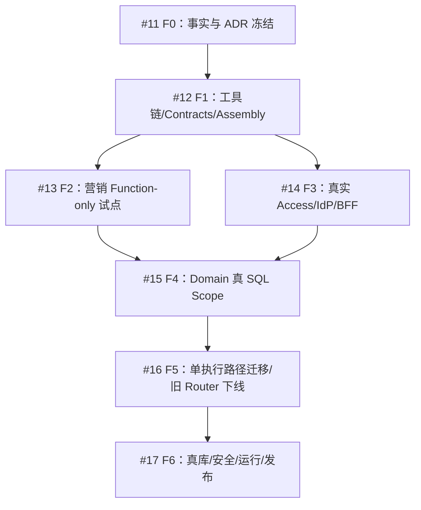

# Yunka 引入 F0–F6 阶段任务书（cs-biz 三权体系）

> **阶段任务权威：[#10](https://github.com/hvritual/cs-biz/issues/10)**。子 Issue #11–#17。本文是 2026-10-15 的目标分解，不代表任何迁移已经完成，亦不批量授权未来 PR 的合并/部署。

## 当前进展与源事实

- main@f088a90fd5a0305cc00a5679e368306dce62167f：S01 Vue/Vben/Element Plus 本地 Mock、Go 1.23 `internal/platform/authz` V2 基础库、六 Skill SDLC 已合并。没有生产 IAM、数据库、Yunka Consumer。
- [PR #7](https://github.com/hvritual/cs-biz/pull/7)：账号生命周期/0-1-N 企业选择第一切片，未合并。不是 IdP。
- [PR #8](https://github.com/hvritual/cs-biz/pull/8)：MenuGrant 与逐功能 Function/Scope 的前端 Mock 和 Go TrustedScope 切片，独立候选 Full 20 passed、1 skipped，未合并，依赖 #7。
- `Yunka@352748832503...`：typed PB + Gateway Operation Authz + OperationGuard + C9 Executor/UoW + C10 Assembly + C11 dev tooling。要求 Go 1.25.13/protoc 3.21.12；是否存在可直接消费的完整版本及本仓库真实兼容需 F0/F1 证明。

## 阶段依赖

F3 可以在 F2 后半程按冻结的 Access Adapter 合同并行**准备**，但真链验收必须依赖已接受的前置事实。任何单个阶段不自动使全部 SaaS Done。

## MVP Roadmap：F0–F3 的一条真实纵向链

| 阶段/Issue | 目标 | 不做什么 | 关键输出/验收 |
| --- | --- | --- | --- |
| [F0/#11](https://github.com/hvritual/cs-biz/issues/11) | 冻结 PR #7/#8 身份/三权、现有 Go Router 与 Yunka 事实边界 | 不改生产身份/数据，不声称已迁移 | ADR、兼容性矩阵、确切 Go/protoc/模块发布锁、MKT/CON/TEN/REV 负例 |
| [F1/#12](https://github.com/hvritual/cs-biz/issues/12) | Yunka 作为 Consumer 的合同和生成闭环 | 不把生成物当真实业务，不消费浮动 main | `yunka init/generate/check`、第二次生成零漂移、Go 编译、依赖/源码门禁；后端仅单一计划内运行时 |
| [F2/#13](https://github.com/hvritual/cs-biz/issues/13) | 一条无 Console Menu 的营销 Function/Scope 真实 Operation | 不引另一套 IAM Role DB，不把 Mock 当 API | Typed PB/REST、可信 Principal/GrantResolver/Guard、营销本人数据/跨租户/无菜单越权测试 |
| [F3/#14](https://github.com/hvritual/cs-biz/issues/14) | 真实 Account/Membership/Role/Menu/Function+Scope 的当前权威；BFF 与每标签 Workspace | 不信任客户端 user/tenant、平台不继承 Owner | 真 Session/CSRF、0/1/N、A/B 标签、最后 Owner CAS、撤权恢复真 DB/API 正反例 |

**MVP 不以一个干净的新仓库为目标**：必须复用现有 cs-biz Vue Console、目标 Marketing 入口、权限数据模型和可核验的真实 API；不能“先搭框架”但基础成员管理永远欠账。首个完整闭环为：账号验证→租户选择→Menu 入口/营销入口→Function→当前 Scope→真实资源操作→审计回读。

## Full Runtime Roadmap：F4–F5

| 阶段/Issue | 目标 | 必须执行的验证 |
| --- | --- | --- |
| [F4/#15](https://github.com/hvritual/cs-biz/issues/15) | Domain 专有 SQL 策略与客户/营销真实数据访问 | 列表、详情、写入、批量、统计、导出强制 Tenant AND Scope；READ=tenant UPDATE=self；组权限无默认扩大；拒绝无副作用 |
| [F5/#16](https://github.com/hvritual/cs-biz/issues/16) | 用唯一 canonical OperationPlan/Executor 覆盖目标 REST/gRPC/Worker/Child | 注册/绑定覆盖率，权限动作/transport/资源归属一致，无旧 HTTPRouter 生产旁路，切换/回滚可复查 |

F5 前的双栈只能处于**受控差分验证**：不能同时对同一个真实业务请求给出两个独立放行结果。F5 的“下线”是对经过覆盖、可回滚的真实入口改动，不删除历史审计证据。

## Production Roadmap：F6

[F6/#17](https://github.com/hvritual/cs-biz/issues/17) 验收：固定 Yunka/Consumer/生成器/DB migration/IdP 身份；真 MySQL 与实际 Tenant/Grant/Scope 并发；持久幂等重复抑制 + 业务状态回读；审计、Outbox/消息，访问撤销、安全负例、故障恢复、灰度发布、回滚与 main/生产精确版本回读。Yunka 的 MySQL 通过证据不能替代 cs-biz 实际消费者真库测试。

## 每阶段执行矩阵

| 切片 | 必须提供的输入 | 允许改动范围（再按 Issue 收窄） | 禁止改动 | 标准出口 | Codex 单次完成? |
| --- | --- | --- | --- | --- | --- |
| F0 | 冻结源 SHA、目标、风险/人审、PR #7/#8 | `doc/architecture,doc/contracts,doc/tasks` | 不改安全运行时 | ADR、方案/负例、可复查事实 | 是 |
| F1 | 准入工具链/依赖锁/项目 profile | `backend/contracts,backend/ci,backend/...`、受控 doc | 不改生成物、不推生产配置 | Go compile，`generate/check` 零漂移 | 可切为 2–3 次 |
| F2 | MKT-01 用户旅程，PB DTO/Scope | 营销 Domain/Guard/Adapter、相关前端 | 不建第二 Authz/Store | 真 REST 与数据负例、幂等结果 | 多切片 |
| F3 | IdP/BFF/DB/会话策略、成员生命周期 | Access/IAM/session/storage/typed clients | 不用 Mock 假认证 | 真 DB/安全/浏览器 | 多切片 |
| F4 | 客户和营销实际资源数据/所有权 | Domain/Repository/SQL、相应测试 | 不改框架权限含义 | DB Scope 全矩阵 | 每业务场景独立 |
| F5 | 路由盘点、操作/消费者兼容与回滚 | 受控入口/assembly/文档 | 不留双授权入口 | Coverage + 回滚 + 跨 transport | 多次 |
| F6 | 环境凭据/运维/审批、负载目标 | `backend/deploy,backend/ci,doc/evidence` | 无批准不部署 | 真 Production 资格证据 | 否，分环境和风险 |

## No-Stall 和独立验收

采用仓库 `doc/ci/NO-STALL-GATES.md` 和现有 SDLC Skill：Intent→Design 预览/人审→受控 Build RED→GREEN→REFACTOR，先低成本 unit/生成/check，再 Go security+DB，前端 Fast/Targeted Desktop，最后按**当前实际 GitHub Workflow 策略**触发完整浏览器门禁。CI 调度变动需以合入 main 的实际 workflow 为准，不能把未合并 PR #9 的“Full 手动触发”当已实行。

每次交付记录 baseline/base SHA、候选 SHA、Yunka 依赖锁、changed paths、commands、go test、generated diff、Vitest、Playwright、真实 MySQL/IdP 证据（适用时）、审查及结果读回。不得让一个状态文本替代 GitHub 原始证据。

**当前所有 F0–F6 实现状态：PLANNED，实际迁移 NOT_IMPLEMENTED。** 本次文档/Issue 建档不等于任何阶段的生产 Done。
