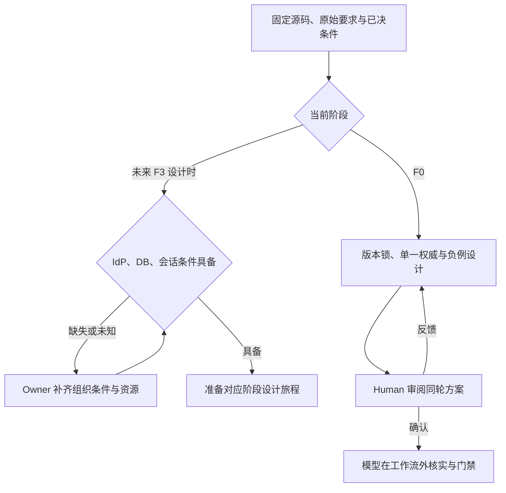

# F0 r005 条件与决策

| ID | 决定或资源 | 来源 / 状态 | 阻塞与下一动作 |
| --- | --- | --- | --- |
| D1 | A：外部发布模块/CLI 制品锁，缺资格先修复 | r002 Human 原文“按照推荐A进行推进” | 已解决；不采用源码快照，不重复询问 |
| D4 | Go1.26.9 + x/net v0.60.0；go1.26.0 由依赖要求 | r004 Human 原文“批准”，目标 Yunka #244 | 已批准；依赖/CLI 实证由模型完成，不豁免安全 |
| D2 | 组织数据库约束：MySQL8.4 / 既定PostgreSQL / 其他供应约束 | unknown；Human/DB Owner；无既定约束时建议评估 MySQL8.4 路线 | 不阻塞 F0 事实冻结，阻塞 F3 DB 实施；不得默选 |
| D3 | 真实 IdP /账号权威：复用企业 OIDC /另选供应 /当前未具备 | unknown；Human/身份 Owner；已具备时推荐复用 | 不阻塞 F0；F3 前提供安全接口与非生产环境，不在仓库贴凭据 |
| C1 | cs-biz 当前源码、固定候选、上游评估/安全/CLI身份 | available；模型已检索固定来源 | 本轮引用摘要，源变更须新轮 |
| C2 | 安全工具链与protoc | 已实际安装核验；精确版本在版本矩阵 | 真正 consumer CI 仍须满足安装根/平台等条件 |
| C3 | 上游模块/CLI资格 | 以 producer-record.json / qualification.md 实际结果为准 | 不等同 cs-biz F1；其生成/API/旧 Authz 单独验证 |
| C4 | #7/#8/#18 main继承 | missing，未合并 | 不假定 main能力、不整体导入其他PR |
| C5 | SessionTTL/退出/邀请/恢复规则 | unknown；产品/安全 Owner | F3 设计前决定，不把示例默认数值上线 |
| C6 | legacy group领域SQL含义 | unknown；产品/领域 Owner | F4 前确权；当前fail closed、不映射tenant/assigned |
| C7 | Trace生产查询权限/采样/留存/删除/SLO | unknown；运维/安全 Owner | F6 前审批/实测，本轮仅冻结原则 |

已知偏好：保留 Vue/Vben/Element Plus/Desktop/换肤/i18n、每标签页企业独立、三权分离、SLS选配/默认JSON stdout、Trace不作身份。自动化负责可核实工程步骤；Human只处理材料性选择。批量导入/前端UX本轮不适用。完整方案尚未获精确版本批准；Full依现行Human控制，#26豁免不延用。

## 阶段条件决策树

此图不启动F3或Full，不产生新授权。已有D1/D4无需重选；未来条件按表中Owner与影响阶段补齐。
