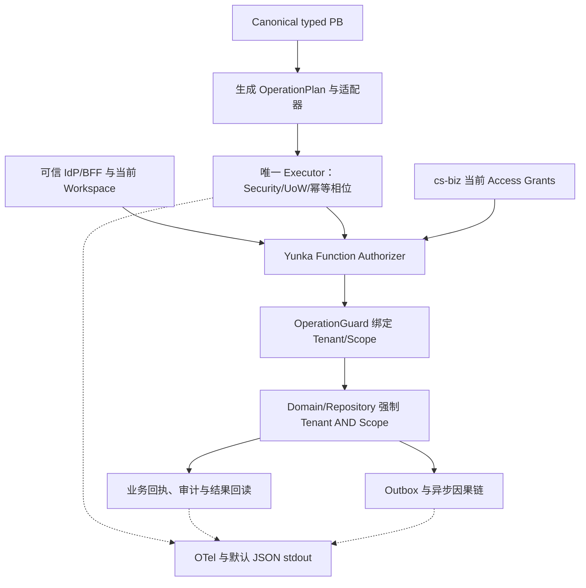

# F0 方案 r005：固定可消费输入与单一权威

状态：DESIGN_REVIEW，完整方案待 Human 审阅。D1=A 与 Go1.26.9 安全前置已批准；不重复选择。原始 #10/#11 与 r001–r004 保留，当前资格见 [qualification](qualification.md)，精确输入见 [版本矩阵](versions.md)。

## 背景、目标与范围

cs-biz main 仍为 da5494d03c362ab873465c1793e7aba7e4e3a7cc，已有 Go Authz V2 与 Vue/Vben/Element Plus Mock。#7/#8/#18 是固定候选，未因本次批准自动合并。F0 解决框架输入、身份/三权/SQL 权责和 F1/F3 准入；本轮不接入 Runtime、改前端或部署。全部 R1–R8 / AC-01–08 与 [负例矩阵](acceptance-matrix.md) 保留。

## 选定方案与使用条件

1. **D1=A，外部模块版本与 CLI 制品锁。** 四个 SDK 模块来源固定为已接受安全提交 bc7c0e1dd6b4e815951130c7acfbf60371445453，实际下载的 version/Origin/sums 与 CLI producer/source/tree/包摘要分别锁定。不用 consumer 源码快照、宿主机 replace、浮动 main 或第二 Runtime。
2. 工具链采用已批准 Go1.26.9 / x/net v0.60.0，依赖要求语言 go1.26.0；protoc3.21.12 与原 RPC plugins 保持。旧 Go1.25.13 制品不继承安全资格。独立框架夹具资格仅证明所列能力，真正 cs-biz F1 仍须旧 Authz 兼容、生成/装配二次零漂移、依赖/源码治理和当前 SHA 运行证据。
3. 单一权威按 [design](design.md)：cs-biz Access 持有实际身份/Grant；typed PB 为目标 Operation 合同可写源；Yunka 负责唯一 Executor/Authorizer/Guard/UoW；Domain 强制 Tenant AND Scope、业务状态与权威回执。Menu、商业可用性、Trace、Outbox published 均不生成业务权限或完成证明。
4. Trace/W3C/CORS/JSON stdout、受控 Collector/Jaeger 和 SLS 选配保持原合同。真实 IdP/DB、Session/邀请/恢复、legacy group、生产查询授权/留存都有 Owner 与后续阻塞阶段，不由模型默选。

系统已自动处理来源检索、下载/校验、依赖/工具链兼容、CLI 构建/消费、失败分类和追溯；Human 只审阅方案、组织资源与风险取舍。D2/D3 不阻塞 F0 事实冻结，必须在 F3 前补齐。

## 备选、代价与边界

源码快照方案 B 增加供应链/维护责任，未采用；暂缓 Yunka 的 C 改变后续路线，也未采用。A 当前制品为有到期日的 CI artifact，具备精确工具链安装根约束，尚非正式版本发布或任意路径可移植 CLI。使用条件必须随锁保留，artifact 到期需重新取得同源资格证据；不能静默换二进制。根许可证文件清单为空，不编造授权条款。

本任务无批量业务对象选定、重复录入或 UI 改动，文本导入/前端 Preview/UX 不适用；[技术旅程](journey.md) 和 [技术图](flow.mmd) 展示责任关系，不能当成可运行产品 demo。后续 UI 任务须在现有 frontend/apps/console 实现 Preview。

## 验收、交接与恢复

本轮交付方案/设计/需求/旅程/流程、来源/锁/负例、资源决策和真实检查证据。完整精确版本 Human 设计确认、独立审阅、当前候选 Full 决定及 main 回读仍是各自条件；部分批准不生成 DESIGN_HANDOFF。模型在已授权范围继续实施与验证，工作流不负责 Build/门禁。

F1 验证不兼容则保留最小失败并在框架/consumer owner 边界修复；身份/DB 缺失保留 F3 阻塞；权限语义改变回 Intent；未知外部结果先权威回读。撤销 F0 文档不改变用户数据。未授权生产发布、其他 PR 合并或批量关闭 Issue。

## 可视化架构关系

同轮 flow.mmd 的责任与事实关系如下，运行状态由相应阶段验证。

