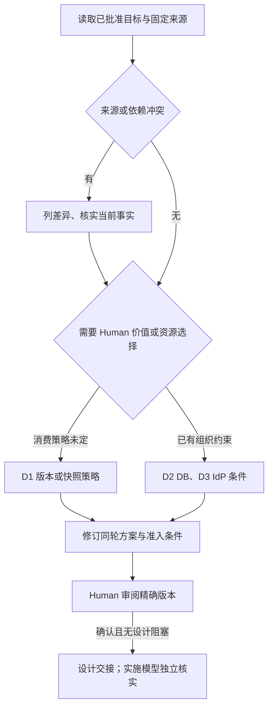

# F0 决策树、条件与偏好 r001

来源检索能解决的事实已经由模型处理；这里只留下会改变方案或后续准入的输入。尚未选择的选项不是授权。

| ID | 问题/触发条件 | 选项、推荐及代价 | 状态与影响 |
| --- | --- | --- | --- |
| D1 | 固定评估源码不等于完整已合格发布组合；首轮 Consumer 必须如何交付？ | **A 推荐：优先完整可消费的发布/CLI 制品锁**，不合格先修上游发布或组合资格；B：接受仓库内固定源码快照/可重建 CLI 作限定 Consumer 输入，承担额外维护和来源审计；C：暂缓 Yunka，不进入 F1 | Human 待选；影响本轮 ADR/F1 准入。A/B 都必须通过真实 Consumer 检查，不以形式代替资格 |
| D2 | 主线架构仍提 proposed PostgreSQL，#10/#17 路线出现 MySQL，组织实际数据库约束未确认 | A：确认 MySQL 8.4（复用 Yunka 现有 MySQL 路线，推荐在无既定约束时评估）；B：既定 PostgreSQL（需明确驱动/迁移/真实兼容成本）；C：已有其他供应约束，说明后再冻结 | Human/DB Owner 待答；不阻塞来源冻结，阻塞 F3 的 DB 实施，不能由 AI 默选 |
| D3 | 真实 IdP、账号权威和账号关联策略未选 | A：复用已有企业 OIDC/账号服务（若已具备则推荐）；B：选定外部/自托管 IdP；C：当前没有，先保留适配合同和缺口 | Human/身份 Owner 待答；没有秘密值入库，不阻塞 F0 事实，阻塞真实身份/会话实施 |

## 已知偏好与无需重复询问的条件

- 当前前端底座/中文英文/换肤/Desktop：来自 accepted ADR 和实际工程，不再重新选型。
- 每标签页企业独立、三权分离、SLS 可选、默认终端日志、Trace 不作权限：来自当前任务与固定候选目标，作为本轮必须保留的设计约束，不扩大为真实能力已实现。
- 设计交接与执行模型分工：来自已合并 #26，不再次询问是否启用；本次已按该入口启动。
- 批量导入/用户任务自动化：本架构任务 N/A，不造 UI；实际前端 Issue 必须重新评估与演示。

## 条件台账（不另建任务状态库）

| 条件 | 可用性 | Owner | 阻塞阶段/下一动作 |
| --- | --- | --- | --- |
| 主线、固定候选和上游源码 | available，摘要已核 | 模型/仓库 | 本轮可继续方案与对账 |
| 完整 Consumer/CLI/模块锁和兼容运行 | unknown，当前证据不足 | 框架维护者 + Consumer 执行模型 | F1 前按 D1 实际下载/编译/生成/二次零漂移 |
| 本执行环境 Go/protoc | 未具备已验证工具链 | 执行环境负责人 | 本轮不运行框架；F1 可在获准云环境建立固定工具链 |
| #7/#8/#18 的 main 继承 | missing，仍未合并 | 相应 PR 的 Human/执行者 | 不把候选当 main；消费前重读批准与合并结果 |
| 实际 IdP、DB 和测试环境 | unknown | Human/身份/DB Owner | F3 前提供安全接口、非生产测试资源及版本；不在聊天/仓库贴密钥 |
| Session TTL、全局退出、邀请渠道和恢复授权 | unknown | 产品/安全 Owner | F3 设计与实现前决定，不把示例默认数值上线 |
| legacy group 的领域 SQL 含义 | unknown | 产品/领域 Owner | F4 前确权；当前 fail closed，不映射 tenant/assigned |
| Trace 生产查询授权/采样/留存/删除/SLO | unknown | 运维/安全 Owner | F6 前批准与实测；F0 仅明确默认最小暴露原则 |

本轮没有 Human 审阅记录；不得把本表中的推荐项标成已选。待选择时可以继续不受影响的资料和方案准备，但不能宣布 F0 已完成或进入 F1。
