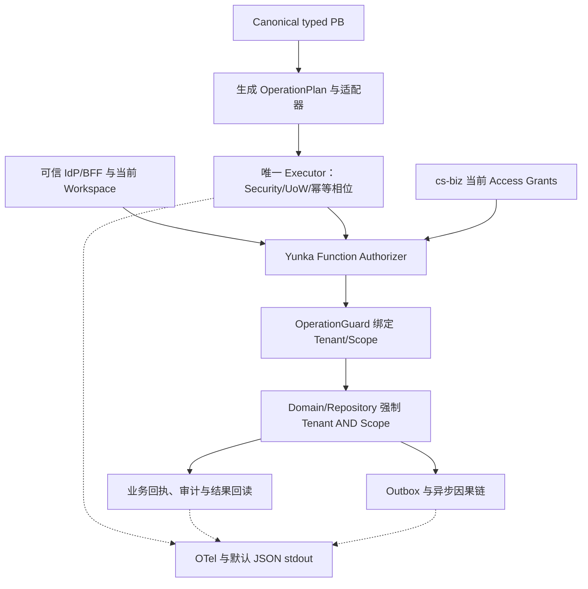

# F0 方案 r001：先冻结可消费条件，再接 Yunka

状态：DESIGN_REVIEW / NEEDS_DECISION；来源为同目录原文和 [38 条固定源码证据](sources.json)。这是 #11 的首个设计轮次，未获本轮 Human 批准。

## 背景、问题与影响范围

用户要求启用已合入的 Intent/Design 工作流并开始完成仓库 Issue。开放 Issue 共 12 个，#11 是 F0–F6 的依赖起点；后续框架生成、营销和真实成员能力依赖它。当前 main 只有 Go Authz V2 库和现有 Vue Mock 应用。PR #7 身份、#8 三权、#18 路线仍未合并；不能把其中设计、页面或历史 CI 说成主线已具备能力。

本轮解决三个准入问题：消费的到底是哪份框架；身份/三权/SQL 谁负责；哪些条件满足后才允许开始 F1/F3。影响后端工具链与合同、前端消费生成物、身份和可观测性边界；本轮运行代码不变。

## 设计目标与使用条件

| 目标 | 本轮可见成果 | 后续真实使用条件 |
| --- | --- | --- |
| 版本可追溯 | main/候选/Yunka、module tag、go.mod 的固定身份 | 所选组合在消费者中下载、编译、生成与零漂移真正通过 |
| 权限不漂移 | 单一执行/授权/数据权威表和负例基准 | 真实 IdP/BFF、当前 Access 持久权威、Domain SQL 和 API |
| 问题可定位 | Trace/Log 合同、默认 stdout、可查询本地后端方案 | 真实 Collector/TraceSource 与当前 Consumer 集成；SLS 为选配 |
| 进展可判断 | 原文→R/AC、依赖/未决项、验证状态 | Human 确认本轮，后续各阶段独立取得相应运行/审核证据 |

已具备：真实仓库源码、当前前端规范、固定上游源码、结构检查。未具备或未知：完整 Yunka Consumer 锁与运行资格、本环境 Go/protoc、真实 IdP/DB 供应端、生产诊断权限/留存配置。秘密值不入文档。

## 推荐方案与备选

1. **推荐：发布身份与消费资格分别冻结。** 记录已有 framework/gateway/pkg tag 的确切提交；不把 tag 名当完整能力证明。F1 使用经批准的 module version/commit/sum 与 CLI 制品锁，在 `GOWORK=off` 的独立 Consumer 验证所需合同/装配/API。app/infras 的消费方式和制品来源须补齐；未通过时留在资格修复，不导入业务 Runtime。
2. **备选：批准固定源码快照作为限定消费者输入。** 必须有仓库内来源快照、内容摘要、许可、明确依赖排除和可重建 CLI；禁止依赖宿主机路径或浮动 main。增加维护/供应链责任，也不能省略资格验证。
3. **暂缓 Yunka：** 保留 Go 1.23 基线；可继续明确业务需求，但不能声称完成 #12–#17 所要求的 Yunka 接入。此为改变路线，必须由 Human 选择。

模块源码与 tag 并非天然不兼容。现有证据仅证明身份和 go.mod 内容不同，**证据不足以确认任一组合已具备本项目全部所需 API**。不根据名称猜伪版本或自动升级。

## 模块流程与自动完成

系统完成来源检索、文件/Git 对象摘要、版本差异、原始要求追溯、链接/结构验证、保留未决项和剩余任务；Human 只判断消费策略、组织约束和风险取舍。技术流程见 [flow](flow.mmd)，权责与契约见 [design](design.md)。

本任务不涉及批量业务对象选定或重复录入，文本导入和 B2B 页面模式不适用。实际业务 Issue 将在现有前端做可操作 Preview，本轮不为架构冻结制造假页面。

## 依赖、风险与范围

- 复用 PR #18 的未批准方向，新增精确资格冻结和差额；不将 PR #18 整体合入，不覆盖 #26 的新工作流和 Human Full 控制。
- #7/#8 可作为固定对照事实；F0 不依赖其已合并，但 F2/F3 实际消费前必须重新核对批准基线和契约差异。
- 源码/文档冲突：旧 `docs/authz.md` 的 @yunka/legacy DB 说明不用于新消费者，typed PB 与当前源码优先用于验证，不能静默复制旧 IAM。
- 工具链从本地 go.mod 的 Go 1.23.0 变为目标最低 Go 1.25.0、固定 go1.25.13；只在 F1 执行，不在 F0 暗改。
- `ScopeKey.With` 仅是上下文容器，不证明权限；幂等抑制不等于响应重放；Trace ID 不证明身份或最终业务效果。
- 不改运行代码、生成文件、Lockfile、CI/Full 或生产配置。可回退为撤销本轮文档候选，不影响当前用户数据。

## Human 需要确认什么

查看 [决策树](decisions.md)：D1 消费策略是本轮关键选择；D2 数据库组织约束、D3 既有 IdP/账号权威可以先提供条件，资源未齐全时在 F3 前保留阻塞。TTL、邀请渠道、legacy group、生产诊断留存等有明确后续 owner/gate，不能由本轮默认批准。批准方案不等于批准 F1 实施、Full、合并或部署。

## 可视化技术关系

以下从同轮 flow.mmd 展示责任与事实流；Security/Guard 在唯一执行路径内调用，不额外创建第二次授权。实际 API 装配由 F1 固定 Consumer 证明。

